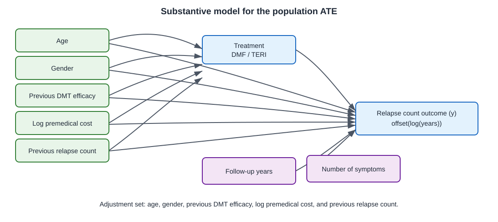
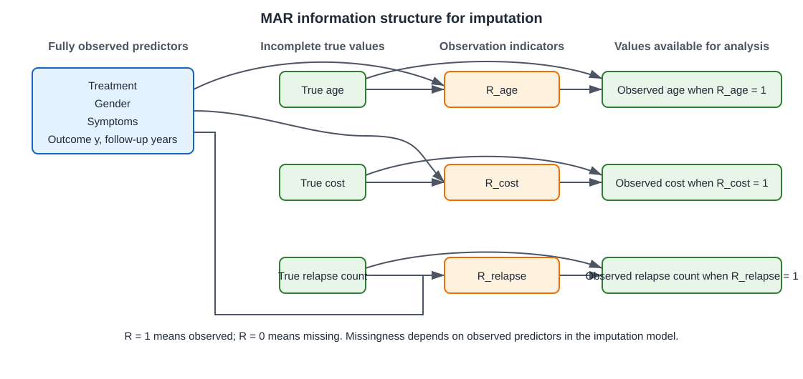
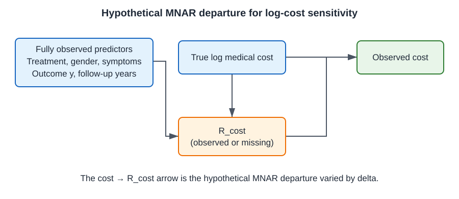

These practicals are based on the online chapter [“Dealing with missing data”](https://smartdata-analysis-and-statistics.github.io/comparative-effectiveness/chapter_09.html), which complements the material in *Comparative Effectiveness and Personalized Medicine Research Using Real-World Data* (pp. 165–202). The book chapter is by Thomas P. A. Debray, Hanne Oberman, and Gerko Vink.

::: {.callout-note title="How to use this solution"}
The corresponding exercises are in the [Homogeneous Treatment Effect practical](chapter10_homogeneous_treatment_effect_task.qmd). This solution follows one analysis from start to finish: define the treatment-effect question, impute incomplete covariates under a MAR working assumption, check the imputations, estimate and pool the effect, then test how the conclusion changes if missing log costs may be MNAR.
:::

## The case continues: from data audit to treatment-effect analysis

In the [exploration practical](chapter10_exploration_task.qmd), you found that age, log premedical cost, and previous relapse count are incomplete. Now use that handoff to estimate the population average treatment effect (ATE). The causal structure, adjustment set, and outcome model are supplied.

The sequence follows a practical MI workflow: initialize and specify the chained-equations model, inspect the imputations, then analyse and pool estimates.

Here, **MAR** means missingness can be explained by variables included in the imputation model; **MNAR** means missingness may still depend on the unobserved value. **PMM** (predictive mean matching) imputes a missing numeric value using observed values from similar records. **FCS** (fully conditional specification) fits one imputation model for each incomplete variable.

## Learning objectives

By the end of this practical, you should be able to:

- specify an analysis-compatible FCS imputation model;
- assess convergence, distributional coherence, and predictive performance;
- estimate and pool the treatment effect using within integration, and describe across integration as an alternative approach; and
- assess sensitivity to an MNAR shift for missing log medical cost.

## 1. Prepare the data

Run the first chunk once to install any packages you do not already have. Then run the second chunk to load the packages, read the saved example data, and define the analysis formulas. The RDS file contains the simulated data with missing values. It was generated with the helper's `MAR_COVARIATE` scenario: missingness is driven by fully observed treatment, gender, symptom count, outcome, and follow-up.

```{r}
#| eval: false
install.packages(c("MatchIt", "MatchThem", "mice", "cobalt",
                   "marginaleffects", "dplyr", "ggplot2", "tidyr"))
```

```{r}
#| eval: true
library(dplyr)
library(ggplot2)
library(MatchIt)
library(MatchThem)
library(cobalt)
library(marginaleffects)
library(mice)
library(tidyr)

sdas_palette <- c(navy = "#26476b", green = "#80c42b", muted = "#5d6873")

data_obs <- readRDS("data/chapter10_exploration_data.rds")

incomplete_vars <- c("age", "logPremedicalcost", "prerelapseNum")

ps_formula <- treatment ~ age + gender + prevDMTefficacy +
  logPremedicalcost + prerelapseNum

outcome_formula <- y ~ treatment + gender + age +
  logPremedicalcost + prerelapseNum + prevDMTefficacy +
  numSymptoms + offset(log(years))
```


## 2. Specify and check the imputation model

### Substantive model DAG

The diagram shows the supplied outcome model and adjustment set for the population ATE.

{fig-cap="Baseline confounders affect treatment and relapse outcome; symptoms and follow-up also predict the outcome."}

### Missing-data diagram for this example

The generated log medical cost is independent of age in this version. In the primary MAR dataset, missingness in age, log medical cost, and pre-relapse count depends on fully observed treatment, gender, symptoms, outcome, and follow-up. These predictors are also included in the imputation models. In the diagram, `R = 1` means observed and `R = 0` means missing.

{fig-cap="Fully observed treatment, gender, symptoms, outcome, and follow-up predict missingness in the three incomplete variables; their true values do not cause their own missingness."}

The missingness indicators have no arrows from the incomplete true values. Conditional on the observed predictors in the diagram, the generated mechanism is MAR.

::: {.callout-note title="Why begin with MAR? A plausible researcher story"}
For example, treatment, outcome, and observed clinical characteristics may reflect differences in care and documentation pathways. Since these predictors are observed, they can be included in the imputation model. This is a known MAR teaching scenario; in real data MAR remains an assumption.
:::

### 2.1 Specify the imputation model

```{r}
#| eval: true

# We add a covariate for log(years)
imp_data <- data_obs %>% mutate(logyears = log(years))

# Specify the conditional imputation models
form_y <- list(
  age ~ prerelapseNum + gender + logPremedicalcost + logyears +
    prevDMTefficacy + numSymptoms + treatment + y,
  logPremedicalcost ~ age + gender + logyears + prevDMTefficacy +
    numSymptoms + treatment + prerelapseNum + y,
  prerelapseNum ~ age + gender + logPremedicalcost + logyears +
    prevDMTefficacy + numSymptoms + treatment + y
)
form_y <- mice::name.formulas(form_y)

# Adopt predictive mean matching for imputing the incomplete variables
imp0 <- mice(imp_data, form = form_y, maxit = 0, printFlag = FALSE)
method <- imp0$method
method[c("age", "logPremedicalcost", "prerelapseNum")] <- "pmm"

# Generate 20 imputed datasets for this teaching run
imp <- mice(imp_data, form = form_y, method = method,
            m = 20, maxit = 20, seed = 1234, printFlag = FALSE)

form_y
class(imp)
imp$method
if (is.null(imp$loggedEvents)) "No logged events" else imp$loggedEvents

```

The formulas define one conditional model for each incomplete variable. The other incomplete variables, complete baseline predictors, treatment, outcome, and log follow-up are included as predictors so that imputation retains the associations relevant to matching and the outcome model. The cost formula contains a linear age term, consistent with the current data generator; do not add age-squared unless the substantive model or data-generation process calls for it. Inspect `imp$method` to confirm PMM was used for the incomplete numeric variables, and inspect `imp$loggedEvents` for messages that may require model revision.

#### Your tasks

1. Identify the three incomplete variables and explain why all three are imputed.
2. For each formula, identify which variables are used to predict the incomplete variable.
3. Explain why the treatment, outcome, follow-up, and substantive-model covariates are included.
4. Inspect `imp$method` and `imp$loggedEvents`. Record whether the initialized methods match your intended model and whether the run reports any events that need investigation.

#### Questions for discussion

- What assumptions are you making when you interpret this FCS model as MAR?
- What useful predictor would you add if it were available, and why?

::: {.callout-tip title="Comments on the tasks and discussion answers"}
**Task 1.** The three incomplete variables are `age`, `logPremedicalcost`, and `prerelapseNum`. Each is imputed because it is used in the propensity-score or outcome analysis, and leaving it incomplete would prevent the planned matching and analysis from using all records.

**Task 2.** The predictors are:

- `age`: `prerelapseNum`, `gender`, `logPremedicalcost`, `logyears`, `prevDMTefficacy`, `numSymptoms`, `treatment`, and `y`.
- `logPremedicalcost`: `age`, `gender`, `logyears`, `prevDMTefficacy`, `numSymptoms`, `treatment`, `prerelapseNum`, and `y`.
- `prerelapseNum`: `age`, `gender`, `logPremedicalcost`, `logyears`, `prevDMTefficacy`, `numSymptoms`, `treatment`, and `y`.

**Task 3.** The formulas include treatment, outcome, follow-up, the other incomplete covariates, and the substantive-model predictors. These preserve the relationships needed for the planned treatment-effect analysis and improve prediction of the missing covariates.

**Task 4.** `imp$method` assigns PMM to all three incomplete numeric variables. The rendered run reports no logged events. For another run, check the printed values rather than assuming these results recur with different data or settings.

**Question: What MAR assumption is being made?** Conditional on the observed predictors in the imputation model, the chance a value is missing does not additionally depend on that unseen value. This is the working assumption for the primary analysis.

**Question: What useful predictor could be added?** A prior-year cost measure could help predict current cost and its missingness. It could be included as an auxiliary imputation predictor even if it is not part of the causal adjustment set.

:::

### 2.2 Check convergence and distributional coherence

```{r}
#| eval: true

# Summarize mixing directly from mice's stored chain means. This uses the
# classical, unsplit Gelman-Rubin PSRF and average lag-1 correlation; it does
# not require the optional rstan package used by mice::convergence().
final_convergence <- do.call(rbind, lapply(incomplete_vars, function(variable) {
  chain_means <- matrix(
    imp$chainMean[variable, seq_len(imp$iteration), , drop = FALSE],
    nrow = imp$iteration,
    ncol = imp$m
  )
  n_iter <- nrow(chain_means)
  within_var <- mean(apply(chain_means, 2, stats::var))
  between_var <- n_iter * stats::var(colMeans(chain_means))
  var_estimate <- ((n_iter - 1) / n_iter) * within_var + between_var / n_iter
  lag_cor <- vapply(seq_len(n_iter - 1), function(i) {
    stats::cor(chain_means[i, ], chain_means[i + 1, ])
  }, numeric(1))
  lag_cor[!is.finite(lag_cor)] <- 0
  data.frame(
    variable = variable,
    psrf = sqrt(var_estimate / within_var),
    lag1_autocorrelation = mean(lag_cor)
  )
}))
final_convergence

# Trace plots show imputed chain means and standard deviations across iterations.
plot(imp)

# Compare observed values with imputed values for incomplete variables
densityplot(imp, ~ age + logPremedicalcost + prerelapseNum)
```

#### Your tasks

1. Report the final PSRF and lag-1 autocorrelation for each incomplete variable. Is the PSRF close to 1? Do the trace plots show persistent drift or separated chains? Explain why these checks do not prove the imputation model is correct.
2. Compare the observed and imputed distributions in the combined density plot. Do the imputed values look plausible for each variable?
3. Use the trace and density plots as initial checks, then explain why marginal plots alone cannot confirm that relationships among treatment, outcome, and covariates are preserved.
4. Record any issue and one change you would make to the imputation model.

#### Questions for discussion

- Which diagnostic would make you stop and revise the imputation model?
- Why can similar marginal distributions still hide a poorly specified imputation model?
- Which additional conditional or substantive-model check would help you assess relationships that the marginal density plot cannot show?


::: {.callout-tip title="Comments on the tasks and discussion answers"}
**Task 1.** Read the classical PSRF and average lag-1 correlation for each incomplete variable from the table above. Values near 1 suggest similar within- and between-chain variability, while the trace plots should be checked for sustained drift or clearly separated chains. These diagnostics do not prove the imputation model is correctly specified or that the chains have fully converged.

**Task 2.** The observed and imputed density curves overlap reasonably and the imputed values look plausible for these variables. Treat this as a visual check, not a formal confirmation.

**Task 3.** Similar marginal distributions do not show whether conditional relationships with treatment, outcome, and other covariates are preserved. The over-imputation check in Section 2.3 adds a predictive check for observed log costs; conditional plots or comparisons of key associations would add further evidence.

**Task 4.** No major issue is evident in these diagnostics. If there were drift, separated traces, implausible values, or poor conditional fit, revise the predictors or functional forms and rerun the checks.

**Question: Which diagnostic would prompt revision?** Persistent trace drift, clearly separated chains, large or increasing PSRF, implausible imputed values, or a poor predictive check would prompt investigation and possible model revision.

**Question: Why can similar marginal distributions hide misspecification?** A marginal plot averages over other variables. It can look right even when the conditional association between an incomplete variable and treatment, outcome, or another covariate is wrong.

**Question: What additional check would help?** Compare observed and imputed relationships conditional on treatment or outcome, and inspect whether completed-data relationships support the planned outcome model. The over-imputation predictive check is one such targeted check for log cost.
:::

### 2.3 Posterior predictive check for log costs

Use `mice`'s `where` matrix to generate predictive replicates for observed log costs, then compare each observed value with its predictive mean and 95% interval. This checks whether the fitted conditional model reproduces observed costs. It cannot reveal the true values of originally missing costs or identify the missingness mechanism.

```{r}
#| eval: true
# Over-impute observed costs while imputing originally missing values as usual.
where_ppc <- mice::make.where(imp_data)
where_ppc[, "logPremedicalcost"] <- TRUE
imp_ppc <- mice(
  imp_data, form = form_y, method = method, where = where_ppc,
  m = 100, maxit = 20, seed = 5678, printFlag = FALSE
)

# Extract predictive draws for rows with observed log costs.
cost_draws <- imp_ppc$imp$logPremedicalcost
observed_rows <- as.integer(rownames(cost_draws))
observed_rows <- observed_rows[!is.na(imp_data$logPremedicalcost[observed_rows])]
draws <- as.matrix(cost_draws[as.character(observed_rows), , drop = FALSE])
observed_cost <- imp_data$logPremedicalcost[observed_rows]
check_points <- tibble(
  age = imp_data$age[observed_rows],
  observed = observed_cost,
  predictive_mean = rowMeans(draws),
  lower = apply(draws, 1, quantile, probs = 0.025),
  upper = apply(draws, 1, quantile, probs = 0.975)
) %>%
  mutate(covered = observed >= lower & observed <= upper)

coverage_test <- binom.test(sum(check_points$covered), nrow(check_points))
diagnostic_summary <- check_points %>%
  summarise(
    n_covered = sum(covered),
    n_observed = n(),
    coverage = mean(check_points$covered),
    coverage_ci_low = unname(coverage_test$conf.int[1]),
    coverage_ci_high = unname(coverage_test$conf.int[2]),
    mean_absolute_distance = mean(abs(observed - predictive_mean)),
    mean_interval_width = mean(upper - lower)
  )
print(diagnostic_summary, width = Inf)

# Show 60 cases for readability; the numerical summary above uses every observed cost.
set.seed(1234)
plot_points <- check_points %>%
  dplyr::filter(!is.na(age)) %>%
  dplyr::slice_sample(n = 60)

ggplot(plot_points, aes(age, observed, color = covered)) +
  geom_linerange(aes(ymin = lower, ymax = upper), alpha = 0.35) +
  geom_point() +
  geom_point(aes(y = predictive_mean), color = sdas_palette[["navy"]],
             shape = 4) +
  scale_color_manual(values = c("TRUE" = sdas_palette[["green"]],
                                "FALSE" = sdas_palette[["muted"]]),
                     labels = c("TRUE" = "Covered", "FALSE" = "Not covered"),
                     name = "Observed value") +
  labs(x = "Age", y = "Log pre-medical cost",
       title = "Posterior predictive check: log cost",
       subtitle = "60 observed cases shown; summary uses all observed costs",
       caption = "Green and grey points show whether observed costs fall inside predictive intervals; navy crosses are predictive means.") +
  theme_minimal()
```

#### Your tasks

1. Use `mice::make.where()` to create the usual missing-value mask, then request imputation for every `logPremedicalcost` value, including observed values.
2. Run the same imputation model for 100 datasets.
3. Compare each observed cost with its predictive mean and 95% interval. Summarize interval coverage, distance from the predictive mean, and interval width.
4. Explain what this observed-data check can and cannot tell you.

#### Questions for discussion

- What proportion of the observed values falls inside the 95% predictive intervals?
- Does the plotted subset suggest an age pattern? Why should you also inspect the numerical summary?
- Why does this check not tell you whether the originally missing costs are imputed correctly?

Green points fall inside their 95% predictive intervals; grey points fall outside. Navy crosses mark predictive means and vertical lines show the intervals. Only 60 cases with observed age are plotted for readability; the numerical summary uses all observed log costs.

::: {.callout-tip title="Comments on the tasks and discussion answers"}
**Task 1.** `make.where()` starts with the usual missing-value mask; setting the cost column to `TRUE` requests imputation for observed as well as originally missing costs.

**Task 2.** The over-imputation run uses the same formulas and methods, with **100 imputations** and the requested cost-column mask.

**Task 3.** **2,490 of 2,654 observed costs (93.8%)** fall inside their 95% predictive intervals; the binomial 95% interval is **92.8% to 94.7%**. The mean absolute distance from the predictive mean is **0.792**, and the mean interval width is **3.75** log-cost units. The plot displays 60 cases, whereas the summary uses all observed costs.

**Task 4.** This check assesses whether the fitted model can reproduce observed costs. It cannot validate originally missing costs or identify the missingness mechanism, because their true values are unavailable.

**Question: What proportion is covered?** **93.8%** (2,490 of 2,654) of the observed costs, slightly below the nominal 95% in this run.

**Question: Does the plotted subset show an age pattern, and why use the numerical summary?** It shows no clear age pattern, consistent with the generator's cost being independent of age. The subset is only 60 cases, so the numeric summary is more representative of all 2,654 observed costs.

**Question: Why can the check not assess originally missing costs?** Their true values are unknown, so there is nothing to compare the imputations against. Good prediction of observed costs also does not identify whether missingness is MAR or MNAR.
:::

::: {.callout-note title="Further reading: posterior predictive checking"}
Cai, van Buuren, and Vink (2023) propose graphical and numerical posterior predictive checks for fully conditional specification. The `where` matrix lets `mice` over-impute observed values; this example compares those predictive distributions with observed log costs and summarizes coverage, distance from the predictive center, and interval width. Here, other incomplete predictors are also imputed, so interpret this as a practical check of the chained-equations model rather than a perfect replication of the paper's setup, which assumes the other predictors are observed. [Read the paper](https://doi.org/10.1016/j.heliyon.2023.e17077); [see the `mice` documentation for `where`](https://amices.org/mice/reference/mice.html).
:::


## 3. Pool treatment effects using within integration

The imputation checks are reassuring enough to continue with the planned analysis. Now follow the same three steps for the MAR dataset and, later, for each MNAR sensitivity dataset:

1. **Match within each imputation.** Each completed dataset has a plausible set of covariate values. Estimate propensity scores and perform full matching separately in each one.
2. **Estimate the treatment effect.** Fit the same outcome model in each matched dataset, then calculate one weighted marginal ATE and its standard error.
3. **Pool the results.** Combine the 20 ATE estimates and their variances with Rubin's rules. This gives one estimate and confidence interval that reflect both within- and between-imputation uncertainty.

In a simpler setting, `mice::with()` and `mice::pool()` carry out the model-fitting and pooling steps. Here, matching and a marginal-effect calculation are added, so the function below makes the three steps explicit and uses `mice::pool.scalar()` to pool the ATEs.

### Define a reusable matching-analysis function

The function takes the MAR or delta-adjusted imputation object and a label. It returns the matched datasets, which we use to check covariate balance, and a one-row table with the pooled ATE. Keeping these steps together also makes it easier to repeat the same analysis after changing the cost assumption.

```{r}
#| eval: true
run_within_analysis <- function(imputed_data, analysis_label) {

  # Step 1: match separately within every imputed dataset
  matched_data <- matchthem(
    ps_formula, datasets = imputed_data, method = "full",
    estimand = "ATE", approach = "within", caliper = 0.2,
    std.caliper = TRUE, family = binomial, distance = "glm",
    link = "logit", replace = FALSE
  )

  # Step 2: estimate a weighted marginal ATE in every matched dataset
  completed_data <- complete(matched_data, action = "all")
  models <- lapply(completed_data, \(d) glm(
    outcome_formula, family = poisson(link = "log"),
    data = d, weights = weights
  ))
  models <- Map(marginaleffects::set_modeldata, models, completed_data)
  effects <- lapply(seq_along(models), \(d) avg_comparisons(
    models[[d]], variables = "treatment", newdata = completed_data[[d]],
    wts = completed_data[[d]]$weights, vcov = "HC1"
  ))

  # Step 3: pool ATEs and variances using Rubin's rules
  q <- vapply(effects, \(d) d$estimate[1], numeric(1))
  u <- vapply(effects, \(d) d$std.error[1]^2, numeric(1))
  pooled <- mice::pool.scalar(Q = q, U = u)
  critical_value <- qt(0.975, df = pooled$df)

  result <- tibble(
    analysis = analysis_label,
    estimate = pooled$qbar,
    std_error = sqrt(pooled$t),
    conf_low = pooled$qbar - critical_value * sqrt(pooled$t),
    conf_high = pooled$qbar + critical_value * sqrt(pooled$t)
  )

  list(matched_data = matched_data, result = result)
}
```

### 3.1 Match, estimate, and pool using within integration

Run the function with the MAR imputation object. It performs all three steps; inspect the pooled ATE and check whether matching reduced covariate imbalance.

```{r}
#| eval: true
mar_fit <- run_within_analysis(imp, "MAR: PMM, within")
mdata <- mar_fit$matched_data
mar_result <- mar_fit$result

print(mar_result)
print(bal.tab(mdata, un = TRUE, m.threshold = 0.1))
love.plot(
  mdata, stats = "mean.diffs", abs = TRUE,
  thresholds = c(m = 0.1), var.order = "unadjusted"
)
```

#### Your tasks

1. Review the balance output across imputations. Identify any covariate whose standardized difference remains concerning.
2. Review overlap and the number of patients retained by matching.
3. Estimate the marginal ATE in each matched imputation and pool the estimates.
4. Report the pooled estimate and 95% confidence interval.

#### Questions for discussion

- Why must matching be repeated within each imputed dataset?
- What information does pooling add beyond averaging the point estimates?
- How does between-imputation variability affect the width of the confidence interval?

::: {.callout-tip title="Comments on the tasks and discussion answers"}
**Task 1.** No covariate remains concerning by the 0.1 standardized-difference guide. The largest adjusted absolute difference is below **0.06**.

**Task 2.** The output reports about **847 DMF** and **2,153 TERI** participants matched without weighting, with fewer than one unmatched participant on average in each group; effective sample sizes are about **507 for DMF** and **1,955 for TERI**. The largest adjusted absolute standardized difference is about **0.035**, below the practical's 0.1 guide. The practical does not produce a propensity-score overlap plot, so these outputs alone do not provide a full visual assessment of overlap; add one when overlap itself is a key concern.

**Task 3.** The function estimates one marginal ATE in each imputation and combines estimates and variances using Rubin's rules.

**Task 4.** The pooled MAR ATE is **5.78** (95% CI **5.30 to 6.27**).

**Question: Why repeat matching in every imputed dataset?** Each completed dataset contains different plausible confounder values, which can change propensity scores and matched sets. Matching within each one carries that imputation variation into the effect estimates.

**Question: What does pooling add beyond averaging point estimates?** Rubin's rules combine within-imputation variance with between-imputation variation, so the standard error reflects uncertainty from both sources.

**Question: How does between-imputation variability affect the confidence interval?** More variation among the imputation-specific estimates increases the between-imputation variance and generally widens the pooled confidence interval.
:::

The pooled estimate is the contrast from the marginal outcome predictions, not the treatment coefficient on the log scale. In this example, the MAR within estimate is **5.78** (95% CI **5.30 to 6.27**). Its interval is above zero, but clinical importance still depends on a meaningful-effect threshold chosen for this study.

::: {.callout-note title="Further reading: across integration"}
This practical focuses on **within integration**: match separately in each completed dataset, estimate the effect in each, then pool those effects. An alternative, **across integration**, averages propensity scores across imputations before matching. The approaches use different sequences and can behave differently across settings; the papers below explain and compare them. [Mitra and Reiter (2016)](https://doi.org/10.1177/0962280212445945) compare propensity-score strategies after multiple imputation; [Granger et al. (2019)](https://doi.org/10.1002/sim.8355) examine pitfalls when combining imputation and propensity scores; [Leyrat et al. (2019)](https://doi.org/10.1177/0962280217713032) discuss propensity-score analysis with partially observed covariates. The [MatchThem paper](https://journal.r-project.org/articles/RJ-2021-073/index.html) describes how the package implements matching within and across imputed datasets.
:::

## 4. Apply MNAR delta-adjusted imputation

The primary analysis assumes observed information explains missingness. A plausible concern is that high-cost care happened outside the health system and is therefore missing. If missingness still depends on the true cost after accounting for observed information, it is MNAR.

The diagram shows this hypothetical additional dependence for log cost. It is a sensitivity scenario, not a claim about how the teaching dataset was generated.

{fig-cap=""}

The data cannot tell us how hidden costs differ from their MAR predictions, so choose delta values using external or clinical knowledge where possible. Here, delta adjustment shifts imputed log costs: negative values lower them, positive values raise them, and zero is the MAR reference. On the original cost scale, the multiplier is `exp(delta)`.

```{r}
#| eval: true
delta_values <- c(-0.50, -0.25, 0.25, 0.50)
post <- mice::make.post(imp_data)

imp_mnar_list <- lapply(seq_along(delta_values), \(i) {
  delta <- delta_values[i]
  post_delta <- post
  post_delta["logPremedicalcost"] <- paste0(
    "imp[[j]][, i] <- imp[[j]][, i] + (", delta, ")"
  )
  mice(
    imp_data, form = form_y, method = method, post = post_delta,
    m = 20, maxit = 20, seed = 1234, printFlag = FALSE
  )
})

```

### Your tasks

1. State the delta range, its direction, and why it is plausible for this application.
2. Report the pooled ATE and 95% confidence interval for every delta next to the primary MAR result.
3. Explain whether the size, direction, or clinical interpretation of the estimated effect changes.
4. Identify whether there is a tipping point within the chosen delta range.

#### Questions for discussion

- Can the observed data estimate the delta? Explain.
- Why must you rerun matching and the outcome analysis after changing the imputation model?
- What additional information would help define a clinically plausible delta range?

::: {.callout-tip title="Comments on the tasks and discussion answers"}
**Task 1.** The illustrative delta range is **−0.50 to 0.50**. Negative values lower missing log costs relative to MAR predictions; positive values raise them. These values are scenarios, not estimated from the data, and need clinical or external justification.

**Task 2.** The pooled estimates are: MAR **5.78 (5.30, 6.27)**; delta −0.50 **5.79 (5.30, 6.28)**; delta −0.25 **5.78 (5.24, 6.32)**; delta 0.25 **5.82 (5.33, 6.31)**; delta 0.50 **5.82 (5.35, 6.29)**. Parentheses give 95% confidence intervals.

**Task 3.** Across these scenarios, estimates remain close in size and positive in direction. Every interval remains above zero. Clinical importance cannot be determined without a prespecified meaningful-effect threshold.

**Task 4.** There is no tipping point in the tested range: none of the estimates or intervals reaches or crosses zero.

**Question: Can observed data estimate delta?** No. Delta represents how missing costs differ from their MAR predictions, and the true missing costs are unobserved. External data or expert input is needed to set plausible values.

**Question: Why rerun matching and outcome analysis?** Changing imputed costs changes the completed confounder data, which can change propensity scores, matched sets, and outcome estimates. The entire analysis must be repeated for each scenario.

**Question: What information would help choose delta?** External cost records, validation data, knowledge of care received outside the system, and clinical or data-provider input about the likely size and direction of missing-cost differences.
:::

## 5. Compare MAR and MNAR results

Use the comparison table and plot from the solution to write a short conclusion that:

1. describes the imputation model and why its predictors were selected;
2. summarizes convergence, distributional coherence, predictive checks, and matching balance;
3. reports the pooled MAR ATE and MNAR sensitivity results; and
4. explains which conclusions depend on the missing-data assumptions.

The `run_within_analysis()` function defined in Section 3 is reused for the delta-adjusted imputations. The delta changes the imputations; the function repeats matching, outcome estimation, and pooling for each resulting object.

### Your tasks

1. Describe the imputation model and why its predictors were selected.
2. Summarize convergence, distributional coherence, predictive checks, and matching balance.
3. Report the pooled MAR ATE and MNAR sensitivity results.
4. Explain which conclusions depend on the missing-data assumptions.

### Questions for discussion

- Which aspects of the final conclusion are supported by the observed data, and which depend on MAR or delta assumptions?
- Would you regard the tested delta range as sufficient for a real application? What evidence would guide your choice?

```{r}
#| eval: true
mnar_results <- bind_rows(lapply(seq_along(imp_mnar_list), \(i) {
  result_label <- paste0(
    "Delta-adjusted PMM, within: delta = ", delta_values[i]
  )
  run_within_analysis(imp_mnar_list[[i]], result_label)$result
}))

results_table <- bind_rows(mar_result, mnar_results) %>%
  mutate(across(c(estimate, std_error, conf_low, conf_high), ~ round(.x, 3)))

results_table
```

`pool.scalar()` receives the marginal effect estimates (`Q`) and their variances (`U`) from each imputation. It returns the pooled estimate, total variance, and degrees of freedom used for the confidence interval. Compare the primary PMM MAR estimate with the four delta-adjusted PMM sensitivity estimates. Matching-related uncertainty may not be fully represented by these intervals, so interpret them with that limitation in mind.

This plot compares the primary MAR within estimate with the estimates across the MNAR delta range. The rows are ordered from delta -0.50, delta -0.25, MAR within, delta 0.25, to delta 0.50. The dashed line marks no effect.

```{r}
#| eval: true
plot_order <- c(
  "Delta-adjusted PMM, within: delta = -0.5",
  "Delta-adjusted PMM, within: delta = -0.25",
  "MAR: PMM, within",
  "Delta-adjusted PMM, within: delta = 0.25",
  "Delta-adjusted PMM, within: delta = 0.5"
)

plot_data <- results_table %>%
  mutate(analysis = factor(analysis, levels = rev(plot_order)))

ggplot(plot_data, aes(x = estimate, y = analysis)) +
  geom_vline(xintercept = 0, linetype = "dashed", colour = "grey50") +
  geom_segment(aes(x = conf_low, xend = conf_high,
                   yend = analysis), linewidth = 0.7) +
  geom_point(size = 2.5, colour = sdas_palette[["navy"]]) +
  labs(
    x = "Marginal ATE (95% CI)",
    y = NULL,
    title = "MAR and delta-adjusted PMM treatment-effect estimates"
  ) +
  theme_minimal() +
  theme(panel.grid.minor = element_blank())
```

::: {.callout-tip title="Comments on the tasks and discussion answers"}
**Task 1.** The FCS model uses PMM for age, log cost, and previous relapse count. Its predictors include the other incomplete covariates, baseline predictors, treatment, outcome, and log follow-up to support the planned matching and outcome models.

**Task 2.** The chain-mean PSRF values in the table are close to 1, without clear persistent drift or separated chains. The observed and imputed marginal distributions overlap reasonably and the imputed values look plausible, although marginal agreement does not establish that conditional relationships are preserved. In the over-imputation check, **93.8%** of observed log costs fall inside their 95% predictive intervals (2,490 of 2,654; interval **92.8%–94.7%**); the mean absolute distance is **0.792** and mean interval width is **3.75**. Matching reduces the largest adjusted absolute standardized difference below **0.06**, under the practical's 0.1 guide. These checks support proceeding but do not prove the imputation or analysis models are correct.

**Task 3.** The MAR within estimate is **5.78 (95% CI 5.30 to 6.27)**. Delta estimates are **5.79 (5.30 to 6.28)** at −0.50, **5.78 (5.24 to 6.32)** at −0.25, **5.82 (5.33 to 6.31)** at 0.25, and **5.82 (5.35 to 6.29)** at 0.50.

**Task 4.** These estimates are conditional on the imputation and analysis models. The primary estimate assumes MAR conditional on observed predictors; the sensitivity estimates assume the specified delta shifts for missing log costs. None of the tested deltas reaches a tipping point, but this does not show that MAR is true.

**Question: Which conclusions are supported by observed data, and which rely on assumptions?** Missingness counts, observed-value distributions, over-imputation performance, and balance summaries are data-based diagnostics. The imputed values and pooled ATEs rely on the imputation and analysis models; the MAR estimate relies on MAR, and sensitivity estimates rely on their chosen delta values.

**Question: Is the tested delta range sufficient for a real application?** Not without external justification. The range is illustrative. Use validation or external cost data, clinical input, and knowledge of care outside the contributing system to decide whether it covers plausible differences. A wider or narrower range may be appropriate in a real study.
:::

## References

- Cai, M., van Buuren, S., & Vink, G. (2023). Graphical and numerical diagnostic tools to assess multiple imputation models by posterior predictive checking. *Heliyon, 9*(6), e17077. [https://doi.org/10.1016/j.heliyon.2023.e17077](https://doi.org/10.1016/j.heliyon.2023.e17077)
- Cro, S., Morris, T. P., Kenward, M. G., & Carpenter, J. R. (2020). Sensitivity analysis for clinical trials with missing continuous outcome data using controlled multiple imputation: A practical guide. *Statistics in Medicine, 39*(21), 2815–2842. [https://doi.org/10.1002/sim.8569](https://doi.org/10.1002/sim.8569)
- Debray, T. P. A., Oberman, H., & Vink, G. (2026). Dealing with missing data. In T. P. A. Debray, T.-L. Nguyen, & R. W. Platt (Eds.), *Comparative Effectiveness and Personalized Medicine Research Using Real-World Data* (pp. 165–202). CRC Press. [https://doi.org/10.1201/9781003300809-10](https://doi.org/10.1201/9781003300809-10)
- Leyrat, C., Seaman, S. R., White, I. R., Douglas, I., Smeeth, L., Kim, J., Resche-Rigon, M., Carpenter, J. R., & Williamson, E. J. (2019). Propensity score analysis with partially observed covariates: How should multiple imputation be used? *Statistical Methods in Medical Research, 28*(1), 3–19. [https://doi.org/10.1177/0962280217713032](https://doi.org/10.1177/0962280217713032)
- Oberman, H. I., van Buuren, S., & Vink, G. (2021). Missing the point: Non-convergence in iterative imputation algorithms. *Proceedings of the 24th International Conference on Artificial Intelligence and Statistics*. [https://arxiv.org/abs/2110.11951](https://arxiv.org/abs/2110.11951)
- Rubin, D. B. (1987). *Multiple Imputation for Nonresponse in Surveys*. John Wiley & Sons. [https://doi.org/10.1002/9780470316696](https://doi.org/10.1002/9780470316696)
- van Buuren, S. (2018). *Flexible Imputation of Missing Data* (2nd ed.). CRC Press. [https://doi.org/10.1201/9780429492259](https://doi.org/10.1201/9780429492259)
- van Buuren, S., & Groothuis-Oudshoorn, K. (2011). mice: Multivariate imputation by chained equations in R. *Journal of Statistical Software, 45*(3), 1–67. [https://doi.org/10.18637/jss.v045.i03](https://doi.org/10.18637/jss.v045.i03)
- White, I. R., Royston, P., & Wood, A. M. (2011). Multiple imputation using chained equations: Issues and guidance for practice. *Statistics in Medicine, 30*(4), 377–399. [https://doi.org/10.1002/sim.4067](https://doi.org/10.1002/sim.4067)
