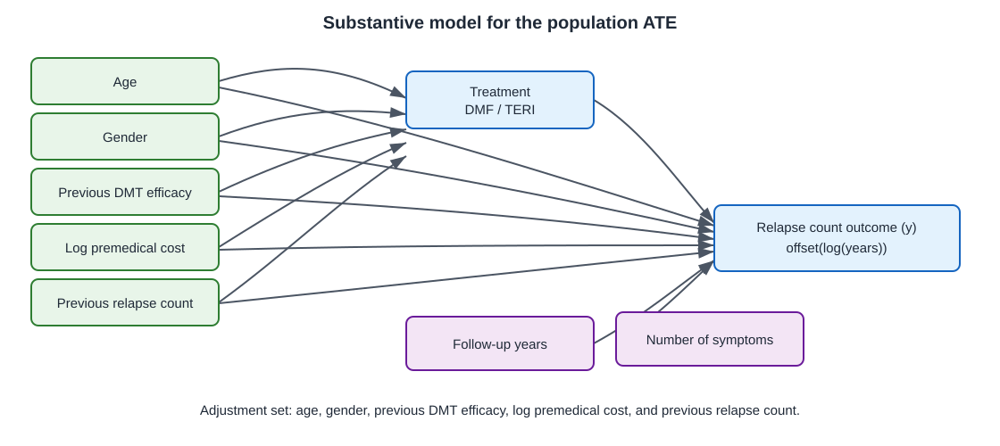
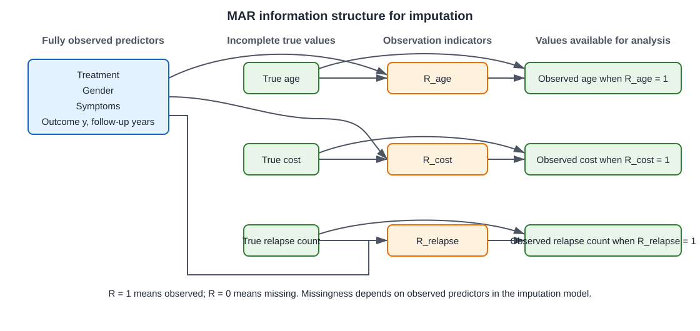
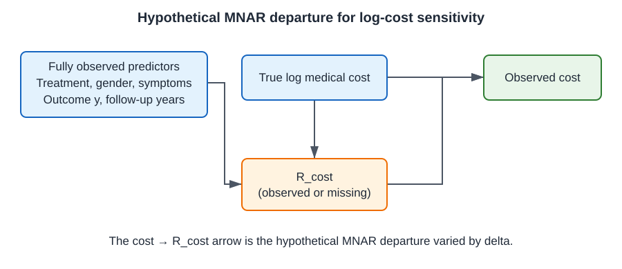

These practicals are based on the online chapter [“Dealing with missing data”](https://smartdata-analysis-and-statistics.github.io/comparative-effectiveness/chapter_09.html), which complements the material in *Comparative Effectiveness and Personalized Medicine Research Using Real-World Data* (pp. 165–202). The book chapter is by Thomas P. A. Debray, Hanne Oberman, and Gerko Vink.
## The case continues: from data audit to treatment-effect analysis

In the [exploration practical](chapter10_exploration_task.qmd), you found that age, log premedical cost, and previous relapse count are incomplete. Now use that handoff to estimate the population average treatment effect (ATE). The causal structure, adjustment set, and outcome model are supplied.

The sequence follows a practical MI workflow: initialize and specify the chained-equations model, inspect the imputations, then analyse and pool estimates.

Here, **MAR** means missingness can be explained by variables included in the imputation model; **MNAR** means missingness may still depend on the unobserved value. **PMM** (predictive mean matching) imputes a missing numeric value using observed values from similar records. **FCS** (fully conditional specification) fits one imputation model for each incomplete variable.

## Learning objectives

By the end of this practical, you should be able to:

- specify an analysis-compatible FCS imputation model;
- assess convergence, distributional coherence, and predictive performance;
- estimate and pool the treatment effect using within integration, and describe across integration as an alternative approach; and
- assess sensitivity to an MNAR shift for missing log medical cost.

## 1. Prepare the data

Run the first chunk once to install any packages you do not already have. Then run the second chunk to load the packages, read the saved example data, and define the analysis formulas. The RDS file contains the simulated data with missing values. It was generated with the helper's `MAR_COVARIATE` scenario: missingness is driven by fully observed treatment, gender, symptom count, outcome, and follow-up.

```{r}
#| eval: false
install.packages(c("MatchIt", "MatchThem", "mice", "cobalt",
                   "marginaleffects", "dplyr", "ggplot2", "tidyr"))
```

```{r}
#| eval: false
library(dplyr)
library(ggplot2)
library(MatchIt)
library(MatchThem)
library(cobalt)
library(marginaleffects)
library(mice)
library(tidyr)

sdas_palette <- c(navy = "#26476b", green = "#80c42b", muted = "#5d6873")

data_obs <- readRDS("data/chapter10_exploration_data.rds")

incomplete_vars <- c("age", "logPremedicalcost", "prerelapseNum")

ps_formula <- treatment ~ age + gender + prevDMTefficacy +
  logPremedicalcost + prerelapseNum

outcome_formula <- y ~ treatment + gender + age +
  logPremedicalcost + prerelapseNum + prevDMTefficacy +
  numSymptoms + offset(log(years))
```


## 2. Specify and check the imputation model

### Substantive model DAG

The diagram shows the supplied outcome model and adjustment set for the population ATE.

{fig-cap="Baseline confounders affect treatment and relapse outcome; symptoms and follow-up also predict the outcome."}

### Missing-data diagram for this example

The generated log medical cost is independent of age in this version. In the primary MAR dataset, missingness in age, log medical cost, and pre-relapse count depends on fully observed treatment, gender, symptoms, outcome, and follow-up. These predictors are also included in the imputation models. In the diagram, `R = 1` means observed and `R = 0` means missing.

{fig-cap="Fully observed treatment, gender, symptoms, outcome, and follow-up predict missingness in the three incomplete variables; their true values do not cause their own missingness."}

The missingness indicators have no arrows from the incomplete true values: conditional on the observed predictors, the generated missingness mechanism is MAR. The diagram describes this teaching data generator; in a real study, the missingness mechanism is not known.

### 2.1 Specify the imputation model

Start with a linear age term in the cost model. Use FCS with one formula for each incomplete covariate. Include the other incomplete covariates, complete baseline predictors, treatment, outcome, and log follow-up. Here, `age`, `logPremedicalcost`, and `prerelapseNum` are incomplete; `prevDMTefficacy` and `numSymptoms` are complete predictors. PMM uses observed donor values, which helps keep imputed values within the observed range.

In each formula, the variable to the left of `~` is the variable being imputed, and the variables to the right are its predictors. Run the chunk, then check that `imp$method` lists `pmm` for the three incomplete variables. This practical uses 20 imputations to keep the exercise manageable; increase `m` for a final analysis when runtime allows.

```{r}
#| eval: false
imp_data <- data_obs %>% mutate(logyears = log(years))
form_y <- list(
  age ~ prerelapseNum + gender + logPremedicalcost + logyears +
    prevDMTefficacy + numSymptoms + treatment + y,
  logPremedicalcost ~ age + gender + logyears + prevDMTefficacy +
    numSymptoms + treatment + prerelapseNum + y,
  prerelapseNum ~ age + gender + logPremedicalcost + logyears +
    prevDMTefficacy + numSymptoms + treatment + y
)
form_y <- mice::name.formulas(form_y)

imp0 <- mice(imp_data, form = form_y, maxit = 0, printFlag = FALSE)
method <- imp0$method
method[c("age", "logPremedicalcost", "prerelapseNum")] <- "pmm"
imp <- mice(imp_data, form = form_y, method = method,
            m = 20, maxit = 20, seed = 1234, printFlag = FALSE)

form_y
class(imp)
imp$method
if (is.null(imp$loggedEvents)) "No logged events" else imp$loggedEvents
```

`mice()` returns a `mids` object: it stores the imputation settings and the completed values across imputations. Run this chunk and inspect the formulas, object class, methods, and logged events. The initial example data are generated under MAR. In Section 4, you will create a separate delta-adjusted sensitivity analysis to examine departures from MAR for log cost. In real data, observed-data checks cannot establish MAR or reveal dependence on a hidden cost.

#### Your tasks

1. Identify the three incomplete variables and explain why all three are imputed.
2. For each formula, identify which variables are used to predict the incomplete variable.
3. Explain why the treatment, outcome, follow-up, and substantive-model covariates are included.
4. Inspect `imp$method` and `imp$loggedEvents`. Record whether the initialized methods match your intended model and whether the run reports any events that need investigation.

#### Questions for discussion

- What assumptions are you making when you interpret this FCS model as MAR?
- What useful predictor would you add if it were available, and why?

### 2.2 Check convergence and distributional coherence

```{r}
#| eval: false
# Summarize mixing directly from mice's stored chain means. This uses the
# classical, unsplit Gelman-Rubin PSRF and average lag-1 correlation; it does
# not require the optional rstan package used by mice::convergence().
final_convergence <- do.call(rbind, lapply(incomplete_vars, function(variable) {
  chain_means <- matrix(
    imp$chainMean[variable, seq_len(imp$iteration), , drop = FALSE],
    nrow = imp$iteration,
    ncol = imp$m
  )
  n_iter <- nrow(chain_means)
  within_var <- mean(apply(chain_means, 2, stats::var))
  between_var <- n_iter * stats::var(colMeans(chain_means))
  var_estimate <- ((n_iter - 1) / n_iter) * within_var + between_var / n_iter
  lag_cor <- vapply(seq_len(n_iter - 1), function(i) {
    stats::cor(chain_means[i, ], chain_means[i + 1, ])
  }, numeric(1))
  lag_cor[!is.finite(lag_cor)] <- 0
  data.frame(
    variable = variable,
    psrf = sqrt(var_estimate / within_var),
    lag1_autocorrelation = mean(lag_cor)
  )
}))
final_convergence

# Trace plots show imputed chain means and standard deviations across iterations.
plot(imp)

densityplot(imp, ~ age + logPremedicalcost + prerelapseNum)
```

The table gives a classical, unsplit Gelman–Rubin potential scale reduction factor (PSRF) and the average lag-1 correlation between successive chain means for each incomplete variable. A PSRF near 1 suggests similar within- and between-chain variability; the autocorrelation summarizes dependence across iterations. These simple diagnostics are calculated from `mice`'s stored chain means and avoid an optional `rstan` dependency. They are not rank-normalized split R-hat diagnostics, and they do not establish convergence or correct model specification. Inspect trace plots for persistent drift or separated chains, and assess whether imputed values and their relationships with treatment and outcome are coherent. Oberman, van Buuren, and Vink (2021) discuss the challenges of assessing convergence in iterative imputation algorithms and the lack of consensus on a single evaluation approach.

#### Your tasks

1. Report the final PSRF and lag-1 autocorrelation for each incomplete variable. Is the PSRF close to 1? Do the trace plots show persistent drift or separated chains? Explain why these checks do not prove the imputation model is correct.
2. Compare the observed and imputed distributions in the combined density plot. Do the imputed values look plausible for each variable?
3. Use the trace and density plots as initial checks, then explain why marginal plots alone cannot confirm that relationships among treatment, outcome, and covariates are preserved.
4. Record any issue and one change you would make to the imputation model.

#### Questions for discussion

- Which diagnostic would make you stop and revise the imputation model?
- Why can similar marginal distributions still hide a poorly specified imputation model?
- Which additional conditional or substantive-model check would help you assess relationships that the marginal density plot cannot show?

### 2.3 Posterior predictive check for log costs

Use `mice`'s `where` matrix to generate predictive replicates for observed log costs, then compare each observed value with its predictive mean and 95% interval. This over-imputation check asks whether the fitted conditional model can reproduce observed costs. It cannot reveal the true values of costs that were originally missing or identify the missingness mechanism.

#### Your tasks

1. Use `mice::make.where()` to create the usual missing-value mask, then request imputation for every `logPremedicalcost` value, including observed values.
2. Run the same imputation model for 100 datasets.
3. Compare each observed cost with its predictive mean and 95% interval. Summarize interval coverage, distance from the predictive mean, and interval width.
4. Explain what this observed-data check can and cannot tell you.

#### Code scaffold

```{r}
#| eval: false
# Request over-imputation for observed costs. Originally missing values are
# still imputed as usual; other variables follow the standard missingness mask.
where_ppc <- mice::make.where(imp_data)
where_ppc[, "logPremedicalcost"] <- TRUE
imp_ppc <- mice(
  imp_data, form = form_y, method = method, where = where_ppc,
  m = 100, maxit = 20, seed = 5678, printFlag = FALSE
)

# Extract the predictive draws for rows with observed log costs.
cost_draws <- imp_ppc$imp$logPremedicalcost
observed_rows <- as.integer(rownames(cost_draws))
observed_rows <- observed_rows[!is.na(imp_data$logPremedicalcost[observed_rows])]
draws <- as.matrix(cost_draws[as.character(observed_rows), , drop = FALSE])
observed_cost <- imp_data$logPremedicalcost[observed_rows]
check_points <- tibble(
  age = imp_data$age[observed_rows],
  observed = observed_cost,
  predictive_mean = rowMeans(draws),
  lower = apply(draws, 1, quantile, probs = 0.025),
  upper = apply(draws, 1, quantile, probs = 0.975)
) %>%
  mutate(covered = observed >= lower & observed <= upper)

coverage_test <- binom.test(sum(check_points$covered), nrow(check_points))
check_points %>%
  summarise(
    n_covered = sum(covered),
    n_observed = n(),
    coverage = mean(check_points$covered),
    coverage_ci_low = unname(coverage_test$conf.int[1]),
    coverage_ci_high = unname(coverage_test$conf.int[2]),
    mean_absolute_distance = mean(abs(observed - predictive_mean)),
    mean_interval_width = mean(upper - lower)
  ) %>%
  print(width = Inf)

# Show 60 cases for readability; the numerical summary above uses every observed cost.
set.seed(1234)
plot_points <- check_points %>%
  dplyr::filter(!is.na(age)) %>%
  dplyr::slice_sample(n = 60)

ggplot(plot_points, aes(age, observed, color = covered)) +
  geom_linerange(aes(ymin = lower, ymax = upper), alpha = 0.35) +
  geom_point() +
  geom_point(aes(y = predictive_mean), color = sdas_palette[["navy"]],
             shape = 4) +
  scale_color_manual(values = c("TRUE" = sdas_palette[["green"]],
                                "FALSE" = sdas_palette[["muted"]]),
                     labels = c("TRUE" = "Covered", "FALSE" = "Not covered"),
                     name = "Observed value") +
  labs(x = "Age", y = "Log pre-medical cost",
       title = "Posterior predictive check: log cost",
       subtitle = "60 observed cases shown; summary uses all observed costs",
       caption = "Green and grey points show whether observed costs fall inside predictive intervals; navy crosses are predictive means.") +
  theme_minimal()
```

Green dots are covered by their 95% predictive intervals; grey dots are outside. Navy crosses mark predictive means and vertical lines show the intervals. Only 60 cases with observed age are plotted for readability; the numerical summary uses all observed log costs.

With the supplied data, log cost is generated independently of age, so the plotted observed costs and predictive means should show no clear age pattern. Use the numerical summary to assess coverage, mean distance to the predictive mean, and interval width. These describe calibration, predictive error, and uncertainty; none is a pass/fail test. The check uses observed log costs and does not establish how originally missing costs should be imputed.

::: {.callout-note title="Further reading: posterior predictive checking"}
Cai, van Buuren, and Vink (2023) propose graphical and numerical posterior predictive checks for fully conditional specification. The `where` matrix lets `mice` over-impute observed values; this example compares those predictive distributions with observed log costs and summarizes coverage, distance from the predictive center, and interval width. Here, other incomplete predictors are also imputed, so interpret this as a practical check of the chained-equations model rather than a perfect replication of the paper's setup, which assumes the other predictors are observed. [Read the paper](https://doi.org/10.1016/j.heliyon.2023.e17077); [see the `mice` documentation for `where`](https://amices.org/mice/reference/mice.html).
:::

#### Questions for discussion

- What proportion of the observed values falls inside the 95% predictive intervals?
- Does the plotted subset suggest an age pattern? Why should you also inspect the numerical summary?
- Why does this check not tell you whether the originally missing costs are imputed correctly?

## 3. Pool treatment effects using within integration

The imputation model is now ready for the treatment analysis. Follow three steps: match separately within each completed dataset, estimate the weighted marginal ATE in each matched dataset, then pool the estimates and variances. This practical focuses on within integration; across integration is described in a further-reading note.

In a simple analysis, `mice::with()` fits the same model in every imputed dataset and `mice::pool()` combines its estimates. Here, the analysis includes matching followed by a marginal-effect calculation, so the function below explicitly repeats those steps in each matched dataset and passes the resulting estimates and variances to `mice::pool.scalar()`.

### Define a reusable matching-analysis function

The function below takes an imputation object and a result label. It carries out the three within-integration steps and returns both the matched datasets for balance checks and a one-row results table. Define it once, then reuse it for the MAR and delta-adjusted imputations.

```{r}
#| eval: false
run_within_analysis <- function(imputed_data, analysis_label) {
  matched_data <- matchthem(
    ps_formula, datasets = imputed_data, method = "full",
    estimand = "ATE", approach = "within", caliper = 0.2,
    std.caliper = TRUE, family = binomial, distance = "glm",
    link = "logit", replace = FALSE
  )

  completed_data <- complete(matched_data, action = "all")
  models <- lapply(completed_data, \(d) glm(
    outcome_formula, family = poisson(link = "log"),
    data = d, weights = weights
  ))
  models <- Map(marginaleffects::set_modeldata, models, completed_data)
  effects <- lapply(seq_along(models), \(i) avg_comparisons(
    models[[i]], variables = "treatment", newdata = completed_data[[i]],
    wts = completed_data[[i]]$weights, vcov = "HC1"
  ))

  q <- vapply(effects, \(x) x$estimate[1], numeric(1))
  u <- vapply(effects, \(x) x$std.error[1]^2, numeric(1))
  pooled <- mice::pool.scalar(Q = q, U = u)
  critical_value <- qt(0.975, df = pooled$df)
  result <- tibble(
    analysis = analysis_label,
    estimate = pooled$qbar,
    std_error = sqrt(pooled$t),
    conf_low = pooled$qbar - critical_value * sqrt(pooled$t),
    conf_high = pooled$qbar + critical_value * sqrt(pooled$t)
  )

  list(matched_data = matched_data, result = result)
}
```

The matching step is repeated for every imputed dataset because each completed dataset can produce different propensity scores and matched sets. The outcome model then gives one marginal ATE and variance per imputation. In the pooling step, `q` contains those ATE estimates and `u` contains their variances; `mice::pool.scalar()` combines within- and between-imputation uncertainty. The function returns a list: `$matched_data` supports balance checks, while `$result` contains the pooled estimate and confidence interval. `analysis_label` supplies a readable label for that result row.

### 3.1 Match, estimate, and pool using within integration

Call the function with the MAR imputation object and select within integration. Review balance using the matched data it returns and record the pooled MAR estimate. The function's `analysis_label` argument controls the row label in the result.

```{r}
#| eval: false
mar_fit <- run_within_analysis(imp, "MAR: PMM, within")
mar_result <- mar_fit$result
mar_result
bal.tab(mar_fit$matched_data, un = TRUE, m.threshold = 0.1)
love.plot(
  mar_fit$matched_data, stats = "mean.diffs", abs = TRUE,
  thresholds = c(m = 0.1), var.order = "unadjusted"
)
```

The table gives the balance statistics; the Love plot shows absolute standardized mean differences before and after matching with the 0.1 threshold. For MI, `cobalt` summarizes balance across imputations in the plot. For every imputed dataset, estimate the marginal ATE from the same outcome model and pool the estimates and uncertainty. Use the supplied solution as a template for the repeated analysis and Rubin pooling.

#### Your tasks

1. Review the balance output across imputations. Identify any covariate whose standardized difference remains concerning.
2. Review overlap and the number of patients retained by matching.
3. Estimate the marginal ATE in each matched imputation and pool the estimates.
4. Report the pooled estimate and 95% confidence interval.

#### Questions for discussion

- Why must matching be repeated within each imputed dataset?
- What information does pooling add beyond averaging the point estimates?
- How does between-imputation variability affect the width of the confidence interval?

::: {.callout-note title="Further reading: across integration"}
The within workflow above matches separately in each imputed dataset. The across approach first averages propensity scores over imputations, then matches using that averaged score. The methods follow different sequences and their performance can depend on the setting. [Mitra and Reiter (2016)](https://doi.org/10.1177/0962280212445945) compare propensity-score strategies after multiple imputation; [Granger et al. (2019)](https://doi.org/10.1002/sim.8355) examine pitfalls when combining imputation and propensity scores; [Leyrat et al. (2019)](https://doi.org/10.1177/0962280217713032) discuss propensity-score analysis with partially observed covariates. The [MatchThem paper](https://journal.r-project.org/articles/RJ-2021-073/index.html) explains how the package implements matching within and across imputed datasets.
:::

## 4. Apply MNAR delta-adjusted imputation

This second diagram focuses on log cost in the sensitivity analysis. The primary data are generated under MAR, with fully observed treatment, gender, symptoms, outcome, and follow-up predicting cost missingness. The sensitivity analysis considers a hypothetical departure in which missingness also depends on the unobserved true cost.

{fig-cap=""}

The added arrow from true cost to `R_cost` represents the MNAR departure explored by delta adjustment; it is not part of the primary MAR data-generating process. The sensitivity analysis shifts imputed log costs only.

The primary MI analysis uses PMM for `logPremedicalcost` and assumes MAR given the variables in its imputation model. To examine MNAR, keep PMM and apply a delta adjustment to imputed log costs during the MICE iterations. This is a pattern-mixture sensitivity analysis using delta-adjusted PMM; it is not the built-in `mnar.norm` method. A negative delta assumes lower missing log costs than predicted under MAR; a positive delta assumes higher costs. Because the shift is on the log scale, it represents a multiplicative change on the original cost scale.

Examine several plausible shifts using clinical knowledge or external data before interpreting the treatment-effect results. The values below are illustrative, not empirically validated. The primary MAR PMM analysis is the zero-delta reference; the sensitivity grid includes only nonzero shifts. First generate the delta-adjusted imputations. Then repeat the within matching, estimation, and pooling workflow from Section 3.1 for every delta. The `post` argument applies the shift during each imputation iteration, leaving observed costs unchanged.

```{r}
#| eval: false
# Illustrative nonzero log-cost shifts; justify or revise this range.
delta_values <- c(-0.50, -0.25, 0.25, 0.50)

# Generate one imputation object for each delta value.
post <- mice::make.post(imp_data)

imp_mnar_list <- lapply(seq_along(delta_values), \(i) {
  delta <- delta_values[i]
  post_delta <- post
  post_delta["logPremedicalcost"] <- paste0(
    "imp[[j]][, i] <- imp[[j]][, i] + (", delta, ")"
  )
  mice(
    imp_data, form = form_y, method = method, post = post_delta,
    m = 20, maxit = 20, seed = 1234, printFlag = FALSE
  )
})
```

Pass each `imp_mnar_list[[i]]` to the reusable function from Section 3. This repeats within matching, outcome estimation, and pooling for that delta-adjusted imputation object. Compare the results with the primary MAR PMM estimate. Exponentiating a delta gives the multiplicative shift on the original cost scale. For example, shifts of -0.50, -0.25, 0.25, and 0.50 correspond to factors of about 0.61, 0.78, 1.28, and 1.65. With delta zero, the shift disappears and the PMM procedure is the same as the primary MAR reference.

Use the same function for the delta-adjusted imputations:

```{r}
#| eval: false
mnar_results <- bind_rows(lapply(seq_along(imp_mnar_list), \(i) {
  result_label <- paste0(
    "Delta-adjusted PMM, within: delta = ", delta_values[i]
  )
  run_within_analysis(imp_mnar_list[[i]], result_label)$result
}))
mnar_results
```

### Your tasks

1. State the delta range, its direction, and why it is plausible for this application.
2. Report the pooled ATE and 95% confidence interval for every delta next to the primary MAR result.
3. Explain whether the size, direction, or clinical interpretation of the estimated effect changes.
4. Identify whether there is a tipping point within the chosen delta range.

#### Questions for discussion

- Can the observed data estimate the delta? Explain.
- Why must you rerun matching and the outcome analysis after changing the imputation model?
- What additional information would help define a clinically plausible delta range?

| Analysis | Assumption | Pooled ATE and 95% CI | Conclusion |
|---|---|---|---|
| MAR: PMM, within | MAR conditional on the imputation model |  |  |
| Delta-adjusted PMM, within (`delta = -0.50`) | State delta and rationale |  |  |
| Delta-adjusted PMM, within (`delta = -0.25`) | State delta and rationale |  |  |
| Delta-adjusted PMM, within (`delta = 0.25`) | State delta and rationale |  |  |
| Delta-adjusted PMM, within (`delta = 0.50`) | State delta and rationale |  |  |

## 5. Compare MAR and MNAR results

Use the comparison table and plot from the solution to write a short conclusion that:

1. describes the imputation model and why its predictors were selected;
2. summarizes convergence, distributional coherence, predictive checks, and matching balance;
3. reports the pooled MAR ATE and MNAR sensitivity results; and
4. explains which conclusions depend on the missing-data assumptions.

### Questions for discussion

- Which aspects of the final conclusion are supported by the observed data, and which depend on MAR or delta assumptions?
- Would you regard the tested delta range as sufficient for a real application? What evidence would guide your choice?

## References

- Cai, M., van Buuren, S., & Vink, G. (2023). Graphical and numerical diagnostic tools to assess multiple imputation models by posterior predictive checking. *Heliyon, 9*(6), e17077. [https://doi.org/10.1016/j.heliyon.2023.e17077](https://doi.org/10.1016/j.heliyon.2023.e17077)
- Cro, S., Morris, T. P., Kenward, M. G., & Carpenter, J. R. (2020). Sensitivity analysis for clinical trials with missing continuous outcome data using controlled multiple imputation: A practical guide. *Statistics in Medicine, 39*(21), 2815–2842. [https://doi.org/10.1002/sim.8569](https://doi.org/10.1002/sim.8569)
- Debray, T. P. A., Oberman, H., & Vink, G. (2026). Dealing with missing data. In T. P. A. Debray, T.-L. Nguyen, & R. W. Platt (Eds.), *Comparative Effectiveness and Personalized Medicine Research Using Real-World Data* (pp. 165–202). CRC Press. [https://doi.org/10.1201/9781003300809-10](https://doi.org/10.1201/9781003300809-10)
- Leyrat, C., Seaman, S. R., White, I. R., Douglas, I., Smeeth, L., Kim, J., Resche-Rigon, M., Carpenter, J. R., & Williamson, E. J. (2019). Propensity score analysis with partially observed covariates: How should multiple imputation be used? *Statistical Methods in Medical Research, 28*(1), 3–19. [https://doi.org/10.1177/0962280217713032](https://doi.org/10.1177/0962280217713032)
- Oberman, H. I., van Buuren, S., & Vink, G. (2021). Missing the point: Non-convergence in iterative imputation algorithms. *Proceedings of the 24th International Conference on Artificial Intelligence and Statistics*. [https://arxiv.org/abs/2110.11951](https://arxiv.org/abs/2110.11951)
- Rubin, D. B. (1987). *Multiple Imputation for Nonresponse in Surveys*. John Wiley & Sons. [https://doi.org/10.1002/9780470316696](https://doi.org/10.1002/9780470316696)
- van Buuren, S. (2018). *Flexible Imputation of Missing Data* (2nd ed.). CRC Press. [https://doi.org/10.1201/9780429492259](https://doi.org/10.1201/9780429492259)
- van Buuren, S., & Groothuis-Oudshoorn, K. (2011). mice: Multivariate imputation by chained equations in R. *Journal of Statistical Software, 45*(3), 1–67. [https://doi.org/10.18637/jss.v045.i03](https://doi.org/10.18637/jss.v045.i03)
- White, I. R., Royston, P., & Wood, A. M. (2011). Multiple imputation using chained equations: Issues and guidance for practice. *Statistics in Medicine, 30*(4), 377–399. [https://doi.org/10.1002/sim.4067](https://doi.org/10.1002/sim.4067)
