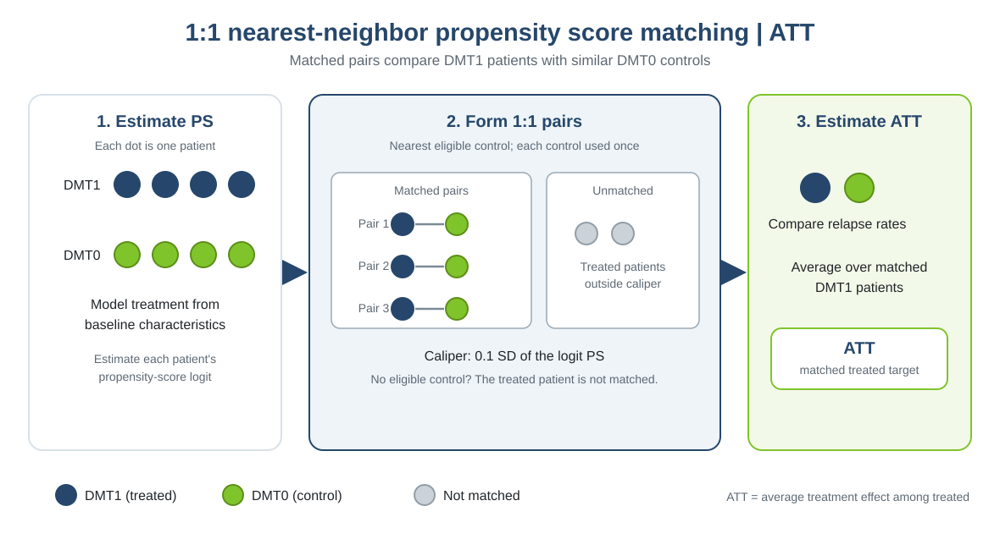

This practical is based on the online chapter [“Confounding adjustment using propensity score methods”](https://smartdata-analysis-and-statistics.github.io/comparative-effectiveness/chapter_06.html), which complements the material in *Comparative Effectiveness and Personalized Medicine Research Using Real-World Data* (pp. 99–123). The book chapter is by Tammy Jiang, Gabrielle Simoneau, Changyu Shen, Fabio Pellegrini, and Carl de Moor.

::: {.callout-note title="How to use this solution"}
The companion [task page](chapter3_practical2_task.qmd) contains the prompts. In this solution, each task is followed immediately by the code that completes it and a comment explaining the result. Discussion questions and answers follow the tasks.
:::

# 1. How matching works

{width=100%}

**When to use:** when the question focuses on treated patients and a direct comparison set is useful.

**Advantages:** fixed 1:1 pairs are easy to inspect, and a caliper limits how far apart matched propensity-score logits can be.

**Limitations:** treated patients without an eligible control inside the caliper are not matched, so the matched ATT can represent a subset of treated patients. Good propensity-score balance does not remove unmeasured confounding.

# 2. Perform and assess matching

```{r}
#| eval: true
library(dplyr)
library(ggplot2)
library(MatchIt)
library(cobalt)
library(marginaleffects)
data_file <- if (file.exists("data/chapter3_ps_data.rds")) {
  "data/chapter3_ps_data.rds"
} else {
  "Chapter_3/data/chapter3_ps_data.rds"
}
dat <- readRDS(data_file)

ps_formula <- treatment ~ age + female + prevDMTefficacy +
  premedicalcost + prerelapse_num + numSymptoms
vars <- c("age", "female", "prevDMTefficacy", "premedicalcost",
          "prerelapse_num", "numSymptoms")
```

Estimate the propensity score from the prespecified baseline covariates, then match each eligible DMT1 patient to one DMT0 patient. The matching settings are shown explicitly below.

```{r}
#| eval: true
opt <- matchit(
  ps_formula, data = dat, method = "nearest", distance = "glm",
  link = "linear.logit", ratio = 1, replace = FALSE,
  caliper = 0.1, std.caliper = TRUE, m.order = "largest",
  estimand = "ATT")
matched_dat <- match.data(opt)
```

**What these settings do:** `method = "nearest"` uses greedy nearest-neighbor matching on the propensity-score distance; `link = "linear.logit"` uses the logit scale. `ratio = 1` requests one control per treated patient, and `replace = FALSE` prevents reusing controls. `caliper = 0.1` with `std.caliper = TRUE` limits pair distances to 0.1 standard deviations of that logit distance. `m.order = "largest"` processes treated patients with the highest scores first. `estimand = "ATT"` makes treated patients the focal group. Patients without an eligible pair are left unmatched.

# 3. Assess the matched design before estimating the ATT

## Common support

Common support asks whether treated and control patients have overlapping propensity-model distance ranges on the linear-logit scale. The plot and table below summarize the intersection of the groups' observed ranges before matching.

```{r}
#| eval: true
dat$logit_ps <- opt$distance
treated_logit <- dat$logit_ps[dat$treatment == "DMT1"]
control_logit <- dat$logit_ps[dat$treatment == "DMT0"]
support_lower <- max(min(treated_logit), min(control_logit))
support_upper <- min(max(treated_logit), max(control_logit))
dat$in_support <- dat$logit_ps >= support_lower & dat$logit_ps <= support_upper

ggplot(dat, aes(x = logit_ps, fill = treatment, colour = treatment)) +
  geom_density(alpha = .22, linewidth = .8, na.rm = TRUE) +
  geom_point(
    aes(y = -.02),
    position = position_jitter(height = .012, width = 0),
    alpha = .35, size = .7, inherit.aes = TRUE, na.rm = TRUE
  ) +
  geom_vline(xintercept = c(support_lower, support_upper),
             linetype = "dashed", linewidth = .6, colour = "#333333") +
  scale_fill_manual(values = c(DMT0 = "#80c42b", DMT1 = "#26476b"),
                    name = "Treatment") +
  scale_colour_manual(values = c(DMT0 = "#80c42b", DMT1 = "#26476b"),
                      guide = "none") +
  labs(x = "Propensity-score logit (propensity-model distance; linear-logit scale)",
       y = "Density",
       title = "Propensity-score (model-distance) distributions before matching",
       subtitle = "Dashed lines mark the common-support range; dots show individual patients") +
  coord_cartesian(ylim = c(-.045, NA)) +
  theme_minimal(base_size = 12) +
  theme(panel.grid.minor = element_blank(),
        panel.grid.major.x = element_blank(),
        plot.title = element_text(face = "bold"),
        legend.position = "bottom")

support_table <- dat %>%
  group_by(treatment) %>%
  summarise(
    n = n(), minimum_logit = round(min(logit_ps), 3),
    maximum_logit = round(max(logit_ps), 3),
    common_support_lower = round(support_lower, 3),
    common_support_upper = round(support_upper, 3),
    n_in_common_support = sum(in_support),
    percent_in_common_support = 100 * mean(in_support),
    .groups = "drop"
  )
support_table
```

::: {.callout-tip title="Comment"}
The overlaid density curves compare the pre-matching logit-distance distributions; the dots show individual patients, and the dashed lines mark the intersection of the groups' observed ranges. In this dataset, most of both groups lies between the support limits (−3.413 and 4.509), and the distributions overlap across much of that interval. The support table counts 7,541 of 7,604 treated patients (99.2%) and 2,308 of 2,396 controls (96.3%) inside the shared range. This range-based check is reassuring, but it does not show whether there are enough nearby controls for every treated patient or whether covariates are balanced after matching.
:::

## Retention

Retention measures how many patients in each treatment group remain matched after applying the design from section 2. Use `summary(opt)` and the table below to report matched, unmatched, and percent retained.

```{r}
#| eval: true
summary(opt)

retention_table <- dat %>%
  count(treatment, name = "n_total") %>%
  left_join(matched_dat %>% count(treatment, name = "n_matched"),
            by = "treatment") %>%
  mutate(
    n_unmatched = n_total - n_matched,
    percent_retained = 100 * n_matched / n_total
  )
retention_table
```

::: {.callout-tip title="Comment"}
The retention table shows how many patients remain after applying the 1:1, no-replacement design and its caliper. In this dataset, 1,996 of 7,604 treated patients (26.2%) and 1,996 of 2,396 controls (83.3%) are retained; 5,608 treated patients and 400 controls are unmatched. The matched ESS is 1,996 in each group. Thus the estimated ATT describes the matched subset of DMT1 patients and should not automatically be generalized to all treated patients.
:::

## Match quality

Check whether each pair is within the caliper. The histogram shows the distribution of absolute treated-control logit-distance differences, expressed in standard-deviation units; the dashed line marks the 0.1-SD caliper.

```{r}
#| eval: true
pair_quality <- matched_dat %>%
  group_by(subclass) %>%
  summarise(
    treated_logit = distance[treatment == "DMT1"][1],
    control_logit = distance[treatment == "DMT0"][1],
    abs_logit_difference = abs(treated_logit - control_logit),
    .groups = "drop"
  ) %>%
  mutate(standardized_difference = abs_logit_difference / sd(opt$distance))

summary(pair_quality$standardized_difference)
ggplot(pair_quality, aes(x = standardized_difference)) +
  geom_histogram(binwidth = .01, colour = "white", fill = "#26476b") +
  geom_vline(xintercept = .1, linetype = 2, colour = "#80c42b") +
  labs(x = "Within-pair logit difference (SD units)", y = "Number of pairs") +
  theme_minimal()
```

::: {.callout-tip title="Comment"}
The histogram shows that pair distances are concentrated near the caliper boundary, with a maximum of 0.100 SD. All pairs satisfy the specified 0.1-SD caliper, although many are close to its limit.
:::

The next density plot compares the propensity-score logit distributions in the matched sample. Close overlap is expected because matching selected controls based on this distance; it is a check of score similarity, not a substitute for checking baseline covariate balance.

```{r}
#| eval: true
ggplot(matched_dat, aes(x = distance, fill = treatment, colour = treatment)) +
  geom_density(alpha = .25, na.rm = TRUE) +
  scale_fill_manual(values = c(DMT0 = "#80c42b", DMT1 = "#26476b")) +
  scale_colour_manual(values = c(DMT0 = "#80c42b", DMT1 = "#26476b")) +
  labs(x = "Propensity-score logit", y = "Density",
       fill = "Treatment", colour = "Treatment") +
  theme_minimal() + theme(legend.position = "bottom")
```

::: {.callout-tip title="Comment"}
The matched distributions overlap closely, with treated and control patients concentrated in similar logit-distance regions. This visual check is consistent with the pair-distance histogram, but score overlap alone does not establish balance on each baseline covariate.
:::

## Covariate balance

Covariate balance checks whether the matched treated and control groups have similar measured baseline characteristics. Here `opt` is the MatchIt object for this matching practical; `w.out` belongs to the weighting practical and is not the object to plot here. Use an absolute standardized mean difference (SMD) below 0.1 as a diagnostic threshold, not as proof that confounding has been eliminated.

```{r}
#| eval: true
#| fig-cap: "MatchIt summary plot of standardized differences before and after matching."
balance_summary <- summary(opt, standardize = TRUE)
plot(summary(opt), position = NULL)
balance_order <- rev(seq_len(nrow(balance_summary$sum.all)))
points(
  x = abs(balance_summary$sum.all[balance_order, "Std. Mean Diff."]),
  y = seq_along(balance_order), pch = 21,
  bg = "#26476b", col = "#26476b"
)
points(
  x = abs(balance_summary$sum.matched[balance_order, "Std. Mean Diff."]),
  y = seq_along(balance_order), pch = 21,
  bg = "#80c42b", col = "#80c42b"
)
legend("bottomright", legend = c("Before matching", "After matching"),
       pch = 21, pt.bg = c("#26476b", "#80c42b"),
       col = c("#26476b", "#80c42b"), bty = "n")
```

This summary plot compares standardized differences before and after matching; points nearer zero indicate closer covariate means, and the dashed threshold marks an absolute SMD of 0.1.

::: {.callout-tip title="Comment"}
In this dataset, every baseline-covariate SMD after matching is below 0.1; the largest is 0.086 for age. The propensity-distance SMD is 0.121, but distance is the matching score rather than a baseline covariate, so assess it alongside the pair-distance and overlap diagnostics.
:::

The covariate density plots compare the distributions of each measured baseline variable between treatment groups before and after matching. They can reveal distributional differences that a mean-based SMD may not show.

```{r}
#| eval: true
# Black line is treated DMT1; grey line is control DMT0.
plot(opt, type = "density", which.xs = vars)
```

::: {.callout-tip title="Comment"}
After matching, the plotted covariate distributions are generally closer between DMT1 and DMT0 than they were before matching, consistent with the SMD results. Review each panel for remaining differences; no plot can assess unmeasured confounding.
:::

The balance table reports the numeric pre- and post-match SMDs. The love plot displays their absolute values together, making it easy to see which covariates meet the 0.1 threshold.

```{r}
#| eval: true
bal.tab(opt, un = TRUE, thresholds = c(m = .1))
love.plot(opt, stats = "mean.diffs", abs = TRUE,
          thresholds = c(m = .1), drop.distance = TRUE,
          sample.names = c("Before matching", "After matching"),
          colors = c("#26476b", "#80c42b"))
```

::: {.callout-tip title="Comment"}
The table and love plot show that all included baseline covariates meet the absolute-SMD threshold in this run; age is closest to the threshold at 0.086. This supports measured-covariate balance in the matched sample, but does not establish that all confounding has been removed.
:::

::: {.callout-note title="Optional: try optimal matching"}
Nearest-neighbor matching makes each match in sequence. Optimal matching chooses all pairs together to minimize their total propensity-score distance. This example does not impose the 0.1-SD caliper. Recheck overlap and balance; do not assume optimal matching will improve them.

```{r}
#| eval: false
optimal <- matchit(
  ps_formula, data = dat, method = "optimal", distance = "glm",
  link = "linear.logit", ratio = 1, estimand = "ATT"
)
summary(optimal)
bal.tab(optimal, un = TRUE, thresholds = c(m = .1))
love.plot(optimal, stats = "mean.diffs", abs = TRUE,
          thresholds = c(m = .1), drop.distance = TRUE)
```
:::


# 4. Estimate the treatment effect

**Task 1.** Report the DMT1-versus-DMT0 IRR and 95% confidence interval. Interpret the estimate in the context of relapse rates.

```{r}
#| eval: true
fit <- glm(y ~ treatment + offset(log(years)), family = poisson(),
           data = matched_dat, weights = weights)
avg_comparisons(
  fit, variables = "treatment", comparison = "ratioavg",
  vcov = ~subclass,
  newdata = subset(matched_dat, treatment == "DMT1"),
  wts = "weights"
)
```

::: {.callout-tip title="Comment and answer"}
Report the estimate and confidence interval printed by `avg_comparisons()`. An IRR below 1 corresponds to an estimated lower relapse rate under DMT1 than DMT0 in the matched target population; an IRR above 1 corresponds to a higher rate.
:::

**Task 2.** Explain how the matched pairs define the ATT target and why treated patients outside the caliper are excluded from the matched estimate.

```{r}
#| eval: true
matched_dat %>%
  group_by(treatment) %>%
  summarise(
    n_matched = n(), .groups = "drop"
  )
```

::: {.callout-tip title="Comment and answer"}
The matched analysis compares DMT1 patients with their selected DMT0 controls. Each matched pair contributes one patient from each group; DMT1 patients without a control within the caliper are excluded, so describe the target as the matched treated patients.
:::

**Questions for discussion:**

1. What does a standardized mean difference near zero after matching tell you, and what does it not tell you?
2. What does matching without replacement mean, and what trade-off does the caliper create?
3. How does restricting the analysis to treated patients with a control inside the caliper affect the ATT target population?
4. Why are covariate balance and overlap both relevant when judging whether the ATT comparison is credible?

::: {.callout-tip title="Comments and answers"}
1. **What does a standardized mean difference near zero after matching tell you, and what does it not tell you?** It indicates little observed difference in that measured covariate between matched groups. It does not show that unmeasured confounders are balanced or prove the causal assumptions.
2. **What does matching without replacement mean, and what trade-off does the caliper create?** Each control is used at most once. The caliper can improve score proximity but may leave treated patients unmatched.
3. **How does restricting the analysis to treated patients with a control inside the caliper affect the ATT target population?** The estimate pertains to matched treated patients and may not generalize to treated patients outside the region of available controls.
4. **Why are covariate balance and overlap both relevant when judging whether the ATT comparison is credible?** Overlap indicates that treated and control patients have comparable propensity-score regions; balance checks whether measured baseline covariates are similar after matching and weighting. Neither diagnostic addresses unmeasured confounding.
:::

::: {.callout-note title="Optional: estimate an ATE with full matching"}
Matching methods do not all support the same estimands. In the MatchIt version used for this practical, `method = "nearest"` supports `"ATT"` and `"ATC"`, but not `"ATE"`. For an ATE, use a method that supports both groups as the target population, such as optimal full matching (`method = "full"`). Full matching creates matched sets with flexible group sizes and uses weights to target the estimand. It requires the `optmatch` package and can take longer to run. This example omits the nearest-neighbor caliper; inspect overlap and balance and report any loss of units.

```{r}
#| eval: false
matched_ate <- matchit(
  ps_formula, data = dat, method = "full", distance = "glm",
  link = "linear.logit", estimand = "ATE"
)
summary(matched_ate, un = TRUE)
matched_ate_dat <- match.data(matched_ate)
fit_ate_match <- glm(
  y ~ treatment + offset(log(years)), family = poisson(),
  data = matched_ate_dat, weights = weights
)
avg_comparisons(
  fit_ate_match, variables = "treatment", comparison = "ratioavg",
  vcov = ~subclass, newdata = matched_ate_dat, wts = "weights"
)
```

Here, `estimand = "ATE"` targets the full eligible population represented by the matched sample, and predictions are averaged over that sample using the full-matching weights. If units are discarded because of poor overlap or additional restrictions, describe the resulting target population accordingly.
:::
