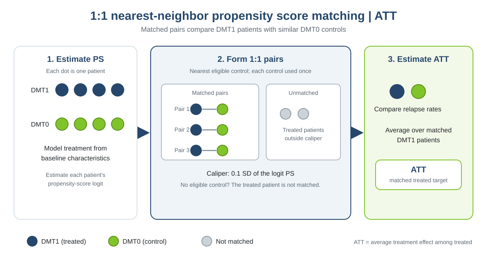

This practical is based on the online chapter [“Confounding adjustment using propensity score methods”](https://smartdata-analysis-and-statistics.github.io/comparative-effectiveness/chapter_06.html), which complements the material in *Comparative Effectiveness and Personalized Medicine Research Using Real-World Data* (pp. 99–123). The book chapter is by Tammy Jiang, Gabrielle Simoneau, Changyu Shen, Fabio Pellegrini, and Carl de Moor.

::: {.callout-note title="How to use this practical"}
Complete the tasks and discussion questions before opening the [worked solution](chapter3_practical2_solution.qmd). The figure and short method summary introduce the analysis.
:::

# 1. How matching works

{width=100%}

**When to use:** when the question focuses on treated patients and a direct comparison set is useful.

**Advantages:** fixed 1:1 pairs are easy to inspect, and a caliper limits how far apart matched propensity-score logits can be.

**Limitations:** treated patients without an eligible control inside the caliper are not matched, so the matched ATT can represent a subset of treated patients. Good propensity-score balance does not remove unmeasured confounding.

# 2. Perform and assess matching

Estimate the average treatment effect among treated patients (ATT): the mean DMT1-versus-DMT0 treatment contrast for those who received DMT1.

```{r}
#| eval: false
install.packages(c("dplyr", "ggplot2", "MatchIt", "cobalt", "marginaleffects", "optmatch"))
library(dplyr)
library(ggplot2)
library(MatchIt)
library(cobalt)
library(marginaleffects)
data_file <- if (file.exists("data/chapter3_ps_data.rds")) {
  "data/chapter3_ps_data.rds"
} else {
  "Chapter_3/data/chapter3_ps_data.rds"
}
dat <- readRDS(data_file)
ps_formula <- treatment ~ age + female + prevDMTefficacy +
  premedicalcost + prerelapse_num + numSymptoms
vars <- c("age", "female", "prevDMTefficacy", "premedicalcost",
          "prerelapse_num", "numSymptoms")
```

Estimate the propensity score from the prespecified baseline covariates, then match each eligible DMT1 patient to one DMT0 patient. The matching settings are shown explicitly below.

```{r}
#| eval: false
opt <- matchit(
  ps_formula, data = dat, method = "nearest", distance = "glm",
  link = "linear.logit", ratio = 1, replace = FALSE,
  caliper = 0.1, std.caliper = TRUE, m.order = "largest",
  estimand = "ATT")
matched_dat <- match.data(opt)
```

**What these settings do:** `method = "nearest"` uses greedy nearest-neighbor matching on the propensity-score distance; `link = "linear.logit"` uses the logit scale. `ratio = 1` requests one control per treated patient, and `replace = FALSE` prevents reusing controls. `caliper = 0.1` with `std.caliper = TRUE` limits pair distances to 0.1 standard deviations of that logit distance. `m.order = "largest"` processes treated patients with the highest scores first. `estimand = "ATT"` makes treated patients the focal group. Patients without an eligible pair are left unmatched.

# 3. Assess the matched design before estimating the ATT

## Common support

Common support asks whether treated and control patients have overlapping propensity-model distance ranges on the linear-logit scale. The plot and table below summarize the intersection of the groups' observed ranges before matching.

```{r}
#| eval: false
dat$logit_ps <- opt$distance
treated_logit <- dat$logit_ps[dat$treatment == "DMT1"]
control_logit <- dat$logit_ps[dat$treatment == "DMT0"]
support_lower <- max(min(treated_logit), min(control_logit))
support_upper <- min(max(treated_logit), max(control_logit))
dat$in_support <- dat$logit_ps >= support_lower & dat$logit_ps <= support_upper

ggplot(dat, aes(x = logit_ps, fill = treatment, colour = treatment)) +
  geom_density(alpha = .22, linewidth = .8, na.rm = TRUE) +
  geom_point(
    aes(y = -.02),
    position = position_jitter(height = .012, width = 0),
    alpha = .35, size = .7, inherit.aes = TRUE, na.rm = TRUE
  ) +
  geom_vline(xintercept = c(support_lower, support_upper),
             linetype = "dashed", linewidth = .6, colour = "#333333") +
  scale_fill_manual(values = c(DMT0 = "#80c42b", DMT1 = "#26476b"),
                    name = "Treatment") +
  scale_colour_manual(values = c(DMT0 = "#80c42b", DMT1 = "#26476b"),
                      guide = "none") +
  labs(x = "Propensity-score logit (propensity-model distance; linear-logit scale)",
       y = "Density",
       title = "Propensity-score (model-distance) distributions before matching",
       subtitle = "Dashed lines mark the common-support range; dots show individual patients") +
  coord_cartesian(ylim = c(-.045, NA)) +
  theme_minimal(base_size = 12) +
  theme(panel.grid.minor = element_blank(),
        panel.grid.major.x = element_blank(),
        plot.title = element_text(face = "bold"),
        legend.position = "bottom")

support_table <- dat %>%
  group_by(treatment) %>%
  summarise(
    n = n(), minimum_logit = round(min(logit_ps), 3),
    maximum_logit = round(max(logit_ps), 3),
    common_support_lower = round(support_lower, 3),
    common_support_upper = round(support_upper, 3),
    n_in_common_support = sum(in_support),
    percent_in_common_support = 100 * mean(in_support),
    .groups = "drop"
  )
support_table
```

Describe what the overlaid density curves, individual dots, and dashed support limits show in this dataset. Report the logit-distance ranges and the number and percentage within the shared range. Then compare these support counts with the retention table: explain why patients can fall within the overall shared range yet remain unmatched under 1:1 matching without replacement and a caliper. Range overlap alone does not establish sufficient local matches or covariate balance.

## Retention

Retention measures how many patients in each treatment group remain matched after applying the design from section 2. Use `summary(opt)` and the table below to report matched, unmatched, and percent retained.

```{r}
#| eval: false
summary(opt)

retention_table <- dat %>%
  count(treatment, name = "n_total") %>%
  left_join(matched_dat %>% count(treatment, name = "n_matched"),
            by = "treatment") %>%
  mutate(
    n_unmatched = n_total - n_matched,
    percent_retained = 100 * n_matched / n_total
  )
retention_table
```

Report matched and unmatched counts, percent retained, and the effective sample size (ESS) from `summary(opt)`. Explain why the matched treated patients define the target population more narrowly than all DMT1 patients.

## Match quality

Check whether each pair is within the caliper. The first plot is a histogram of absolute within-pair logit-distance differences, expressed in standard-deviation units; the dashed line marks the 0.1-SD caliper.

```{r}
#| eval: false
pair_quality <- matched_dat %>%
  group_by(subclass) %>%
  summarise(
    treated_logit = distance[treatment == "DMT1"][1],
    control_logit = distance[treatment == "DMT0"][1],
    abs_logit_difference = abs(treated_logit - control_logit),
    .groups = "drop"
  ) %>%
  mutate(standardized_difference = abs_logit_difference / sd(opt$distance))

summary(pair_quality$standardized_difference)
ggplot(pair_quality, aes(x = standardized_difference)) +
  geom_histogram(binwidth = .01, colour = "white", fill = "#26476b") +
  geom_vline(xintercept = .1, linetype = 2, colour = "#80c42b") +
  labs(x = "Within-pair logit difference (SD units)", y = "Number of pairs") +
  theme_minimal()
```

Comment on the histogram’s shape and maximum: are any pairs beyond the caliper, and are many pairs close to its limit?

The second plot compares the propensity-score logit distributions among matched treated and control patients. It shows how similar the groups are on the score used to form the matches; it does not assess balance on each baseline covariate.

```{r}
#| eval: false
ggplot(matched_dat, aes(x = distance, fill = treatment, colour = treatment)) +
  geom_density(alpha = .25, na.rm = TRUE) +
  scale_fill_manual(values = c(DMT0 = "#80c42b", DMT1 = "#26476b")) +
  scale_colour_manual(values = c(DMT0 = "#80c42b", DMT1 = "#26476b")) +
  labs(x = "Propensity-score logit", y = "Density",
       fill = "Treatment", colour = "Treatment") +
  theme_minimal() + theme(legend.position = "bottom")
```

Comment on how closely the matched score distributions overlap. Together, these plots assess score-distance match quality; use the next section to assess covariate balance.

## Covariate balance

Covariate balance checks whether matched treated and control patients have similar measured baseline characteristics. In this practical the matching result is stored in `opt` (a MatchIt object); `w.out` is used for weighting in Practical 4. Use an absolute standardized mean difference (SMD) below 0.1 as a diagnostic threshold, not as proof that confounding has been eliminated.

```{r}
#| eval: false
plot(summary(opt))
```

The summary plot compares standardized differences before and after matching; points nearer zero indicate closer covariate means. Interpret the post-match covariate values against the 0.1 threshold, and distinguish the propensity distance from baseline covariates.

The covariate density plots compare distributions of measured baseline variables between the treatment groups before and after matching. They can show distributional differences that a mean-based SMD may not capture.

```{r}
#| eval: false
# Black line is treated DMT1; grey line is control DMT0.
plot(opt, type = "density", which.xs = vars)
```

Comment on how the plotted covariate distributions change after matching and identify any remaining differences.

The balance table reports numeric SMDs; the love plot displays their absolute values before and after matching so that covariates meeting the 0.1 threshold are easy to identify.

```{r}
#| eval: false
bal.tab(opt, un = TRUE, thresholds = c(m = .1))
love.plot(opt, stats = "mean.diffs", abs = TRUE,
          thresholds = c(m = .1), drop.distance = TRUE,
          sample.names = c("Before matching", "After matching"),
          colors = c("#26476b", "#80c42b"))
```

Comment on the SMD table and love plot. Identify any covariates above the threshold. Proceed to estimate the ATT only after reviewing overlap, retention, pair distances, and covariate balance.

::: {.callout-note title="Optional: try optimal matching"}
Nearest-neighbor matching makes each match in sequence. Optimal matching instead chooses all pairs together to minimize their total propensity-score distance. It can be compared with the primary analysis, but it does not use the 0.1-SD caliper in this example. Recheck overlap and covariate balance; do not assume the alternative will improve them.

```{r}
#| eval: false
optimal <- matchit(
  ps_formula, data = dat, method = "optimal", distance = "glm",
  link = "linear.logit", ratio = 1, estimand = "ATT"
)
summary(optimal)
bal.tab(optimal, un = TRUE, thresholds = c(m = .1))
love.plot(optimal, stats = "mean.diffs", abs = TRUE,
          thresholds = c(m = .1))
```
:::

# 4. Estimate the treatment effect

Use a Poisson model for relapse counts with follow-up time as an offset. The exponentiated treatment contrast is a relapse rate ratio (IRR).

```{r}
#| eval: false
matched_dat <- match.data(opt)
fit <- glm(y ~ treatment + offset(log(years)), family = poisson(),
           data = matched_dat, weights = weights)
avg_comparisons(fit, variables = "treatment", comparison = "ratioavg",
                vcov = ~subclass,
                newdata = subset(matched_dat, treatment == "DMT1"),
                wts = "weights")
```

**Tasks:**

1. Report the DMT1-versus-DMT0 IRR and 95% confidence interval. Interpret the estimate in the context of relapse rates.
2. Explain how the matched pairs define the ATT target and why treated patients outside the caliper are excluded from the matched estimate.

**Questions for discussion:**

1. What does a standardized mean difference near zero after matching tell you, and what does it not tell you?
2. What does matching without replacement mean, and what trade-off does the caliper create?
3. How does restricting the analysis to treated patients with a control inside the caliper affect the ATT target population?
4. Why are covariate balance and overlap both relevant when judging whether the ATT comparison is credible?

::: {.callout-note title="Optional: estimate an ATE with full matching"}
Matching methods do not all support the same estimands. In the MatchIt version used for this practical, `method = "nearest"` supports `"ATT"` and `"ATC"`, but not `"ATE"`. For an ATE, use a method that supports both groups as the target population, such as optimal full matching (`method = "full"`). Full matching creates matched sets with flexible group sizes and uses weights to target the estimand. It requires the `optmatch` package and can take longer to run. This example omits the nearest-neighbor caliper; inspect overlap and balance and report any loss of units.

```{r}
#| eval: false
matched_ate <- matchit(
  ps_formula, data = dat, method = "full", distance = "glm",
  link = "linear.logit", estimand = "ATE"
)
summary(matched_ate, un = TRUE)
matched_ate_dat <- match.data(matched_ate)
fit_ate_match <- glm(
  y ~ treatment + offset(log(years)), family = poisson(),
  data = matched_ate_dat, weights = weights
)
avg_comparisons(
  fit_ate_match, variables = "treatment", comparison = "ratioavg",
  vcov = ~subclass, newdata = matched_ate_dat, wts = "weights"
)
```

Here, `estimand = "ATE"` targets the full eligible population represented by the matched sample, and predictions are averaged over that sample using the full-matching weights. If units are discarded because of poor overlap or additional restrictions, describe the resulting target population accordingly.
:::
