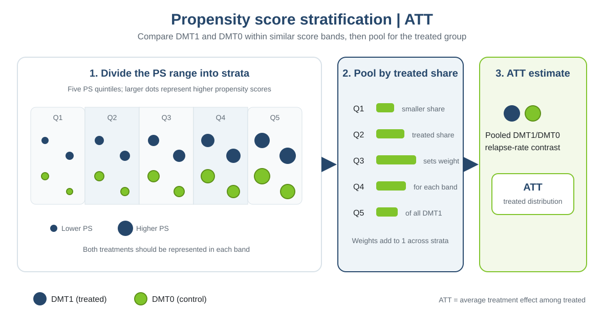

This practical is based on the online chapter [“Confounding adjustment using propensity score methods”](https://smartdata-analysis-and-statistics.github.io/comparative-effectiveness/chapter_06.html), which complements the material in *Comparative Effectiveness and Personalized Medicine Research Using Real-World Data* (pp. 99–123). The book chapter is by Tammy Jiang, Gabrielle Simoneau, Changyu Shen, Fabio Pellegrini, and Carl de Moor.

::: {.callout-note title="How to use this solution"}
The companion [task page](chapter3_practical3_task.qmd) contains the prompts. Review each task and discussion question before the comments and answers below.
:::

# 1. How stratification works

{width=100%}

**When to use:** when a simple, transparent adjustment using a manageable number of score bands is useful and both treatments are represented in each band.

**Advantages:** retains people in the analysis and makes it easy to inspect treatment comparisons across score ranges.

**Limitations:** broad strata may leave within-stratum imbalance; sparse strata can make comparisons unstable. The target depends on how stratum effects are pooled.


## Prepare the data

Estimate each participant's propensity score from the prespecified baseline covariates. Divide the sample into five groups using the 20th, 40th, 60th, and 80th percentiles of the estimated scores. These quintiles are mutually exclusive: every participant is assigned to exactly one interval, from the lowest estimated score (quintile 1) to the highest (quintile 5). The cut points are based on the score distribution in the full sample, not on treatment-specific quantiles. Tied scores can produce fewer than five groups, so check the number formed.

```{r}
#| eval: true
library(dplyr)
library(tableone)
library(ggplot2)
library(marginaleffects)
data_file <- if (file.exists("data/chapter3_ps_data.rds")) {
  "data/chapter3_ps_data.rds"
} else {
  "Chapter_3/data/chapter3_ps_data.rds"
}
dat <- readRDS(data_file)
ps_formula <- treatment ~ age + female + prevDMTefficacy +
  premedicalcost + prerelapse_num + numSymptoms
ps_fit <- glm(ps_formula, data = dat, family = binomial())
dat$ps <- predict(ps_fit, type = "response")
cuts <- unique(quantile(dat$ps, seq(0, 1, .2)))
dat$stratum <- cut(dat$ps, cuts, include.lowest = TRUE, labels = FALSE)
length(unique(dat$stratum))
```

# 2. Feasibility and diagnostics

## Counts of each treatment within each stratum

Start by checking how many participants receiving each treatment fall in each quintile. A stratum must contain both treatments to support a within-stratum comparison; very small counts can still make that comparison unstable.

**Tasks:**

1. Report the treated and control counts in each propensity-score stratum.
2. Identify strata with low counts or a missing treatment group.

```{r}
#| eval: true
counts_by_stratum <- as.data.frame.matrix(with(dat, table(stratum, treatment)))
counts_by_stratum$stratum <- rownames(counts_by_stratum)
counts_by_stratum <- counts_by_stratum[, c("stratum", "DMT0", "DMT1")]
knitr::kable(counts_by_stratum, row.names = FALSE)
```

**Interpretation:** all five strata contain both treatments, so a stratum-specific comparison is possible in each. The 79 DMT0 participants in quintile 5 make that contrast less precise and potentially sensitive to individual observations. Having both groups is necessary, but it does not by itself guarantee adequate positivity or a reliable comparison.

## Within-stratum balance

Within each propensity-score stratum, compare the estimated propensity score and all modeled baseline covariates between DMT1 and DMT0. The table reports means and standard deviations for continuous variables, proportions for categorical variables, and standardized mean differences (SMDs). An absolute SMD below 0.1 is a common diagnostic guide, not proof that confounding has been removed. Also inspect the score distributions within strata; similar means alone can conceal differences in spread or shape.

**Tasks:**

1. Report treatment counts and covariate summaries with SMDs within each stratum.
2. Check whether the estimated propensity score and baseline covariates are adequately balanced in every stratum; identify any weak comparisons.

```{r}
#| eval: true
vars <- c("ps", "age", "female", "prevDMTefficacy", "premedicalcost",
          "prerelapse_num", "numSymptoms")
factor_vars <- c("female", "prevDMTefficacy", "numSymptoms")
balance_by_stratum <- lapply(sort(unique(dat$stratum)), function(s) {
  d <- dat[dat$stratum == s, ]
  tab <- CreateTableOne(
    vars = vars, data = d, factorVars = factor_vars,
    strata = "treatment", test = FALSE
  )
  tab_print <- print(
    tab, catDigits = 2, contDigits = 2, smd = TRUE, printToggle = FALSE
  )
  data.frame(
    stratum = s,
    characteristic = rownames(tab_print),
    DMT0 = tab_print[, "DMT0"],
    DMT1 = tab_print[, "DMT1"],
    SMD = tab_print[, "SMD"],
    row.names = NULL,
    check.names = FALSE
  )
})
knitr::kable(do.call(rbind, balance_by_stratum), row.names = FALSE)
ggplot(dat, aes(x = ps, color = treatment, fill = treatment)) +
  geom_density(alpha = 0.15) +
  facet_wrap(~ stratum, ncol = 1) +
  scale_fill_manual(values = c(DMT0 = "#80c42b", DMT1 = "#26476b")) +
  scale_colour_manual(values = c(DMT0 = "#80c42b", DMT1 = "#26476b")) +
  labs(x = "Estimated propensity score", y = "Density", color = "Treatment",
       fill = "Treatment") +
  theme_minimal()
```

**Interpretation:** inspect each table rather than relying on an overall summary. In this example, the propensity-score SMD is above 0.1 in all five quintiles (0.129 to 0.828), and other baseline covariates also show residual imbalance. Equal-sized quintiles therefore do not ensure within-stratum balance. The density plots show the remaining score-distribution differences; the highest-score quintile is especially thin for DMT0. Revisit the score model or stratification before treating these contrasts as adequately adjusted.

## Does every stratum support a comparison?

Combine treatment counts, within-stratum covariate summaries, propensity-score balance, and the score-density plots to judge support. Every stratum should have both treatment groups, sufficient observations for a stable estimate, and reasonable overlap and balance. If a stratum is too sparse or imbalanced, consider revising the score model or combining adjacent strata only after reassessing balance. Restricting to a supported population changes the target population.

**Tasks:**

1. Based on the treatment counts and balance diagnostics, state whether all five strata support a credible treatment comparison.
2. If one or more strata are too sparse or imbalanced, propose a defensible response and explain its implications for precision or the target population.

::: {.callout-tip title="Comments and answers"}
1. **Based on the treatment counts and balance diagnostics, state whether all five strata support a credible treatment comparison.** All five contain both treatment groups, so numerical contrasts can be estimated. However, the propensity-score SMD exceeds 0.1 in every quintile, and quintile 5 has only 79 DMT0 participants. The current five-stratum design therefore does not achieve adequate measured balance; nonzero group counts alone do not establish credible support.
2. **If one or more strata are too sparse or imbalanced, propose a defensible response and explain its implications for precision or the target population.** Revisit the PS model and inspect which covariates drive the larger SMDs. Combining adjacent strata may improve counts but can worsen residual imbalance; restricting to a supported population changes the target. State the trade-off rather than treating any one response as automatically adequate.
:::

# 4. Estimate and pool the treatment effects

Within each stratum, estimate a DMT1/DMT0 annualized relapse rate ratio (ARR) using a Poisson model with `offset(log(years))`, and calculate a 95% confidence interval. Weight each stratum-specific ARR by that stratum's share of all treated participants. In this practical, the pooled ATT summary is the treated-share-weighted mean of the stratum-specific ARRs. Use a percentile bootstrap to estimate uncertainty, repeating propensity-score estimation, quintile formation, stratum-specific outcome models, and pooling in every resample.

**Tasks:**

1. Fit a Poisson outcome model separately within each stratum and report the DMT1/DMT0 ARR and its 95% confidence interval.
2. Calculate each stratum's treated-share weight and weighted ARR contribution, then sum the contributions to obtain the pooled ATT summary.
3. Bootstrap the pooled estimate and report its percentile 95% confidence interval. Explain why the bootstrap repeats the full propensity-score and stratification procedure.

```{r}
#| eval: true
# Fit stratum-specific Poisson models and calculate rate ratios and Wald CIs.
strata <- sort(unique(dat$stratum))
stratum_effects <- do.call(rbind, lapply(strata, function(h) {
  d <- dat[dat$stratum == h, ]
  fit <- glm(y ~ treatment + offset(log(years)),
             family = poisson(link = "log"), data = d)
  beta <- coef(fit)["treatmentDMT1"]
  se <- sqrt(vcov(fit)["treatmentDMT1", "treatmentDMT1"])
  data.frame(
    stratum = h,
    n_DMT0 = sum(d$treatment == "DMT0"),
    n_DMT1 = sum(d$treatment == "DMT1"),
    ARR = unname(exp(beta)),
    ci_lower = unname(exp(beta - 1.96 * se)),
    ci_upper = unname(exp(beta + 1.96 * se))
  )
}))
stratum_effects$att_weight <- stratum_effects$n_DMT1 /
  sum(stratum_effects$n_DMT1)
stratum_effects$weighted_ARR <- stratum_effects$att_weight *
  stratum_effects$ARR
knitr::kable(stratum_effects, digits = 3)
pooled_ATT <- sum(stratum_effects$weighted_ARR)

# Bootstrap the full PS, quintile, outcome-model, and pooling procedure.
stratified_att <- function(data, indices) {
  d <- data[indices, , drop = FALSE]
  ps_fit_b <- try(glm(ps_formula, data = d, family = binomial()), silent = TRUE)
  if (inherits(ps_fit_b, "try-error")) return(NA_real_)
  d$ps <- predict(ps_fit_b, type = "response")
  cuts_b <- unique(quantile(d$ps, probs = seq(0, 1, .2)))
  if (length(cuts_b) != 6) return(NA_real_)
  d$stratum <- cut(d$ps, cuts_b, include.lowest = TRUE, labels = FALSE)
  group_counts <- table(factor(d$stratum, levels = 1:5), d$treatment)
  if (any(group_counts == 0)) return(NA_real_)
  effects_b <- lapply(1:5, function(h) {
    dh <- d[d$stratum == h, ]
    fit <- try(glm(y ~ treatment + offset(log(years)),
                   family = poisson(link = "log"), data = dh), silent = TRUE)
    if (inherits(fit, "try-error")) return(c(n_DMT1 = NA_real_, ARR = NA_real_))
    beta <- coef(fit)["treatmentDMT1"]
    c(n_DMT1 = sum(dh$treatment == "DMT1"), ARR = unname(exp(beta)))
  })
  effects_b <- do.call(rbind, effects_b)
  if (any(!is.finite(effects_b))) return(NA_real_)
  weights_b <- effects_b[, "n_DMT1"] / sum(effects_b[, "n_DMT1"])
  sum(weights_b * effects_b[, "ARR"])
}

set.seed(1854)
n_boot <- 500
boot_ATT <- replicate(
  n_boot,
  stratified_att(dat, sample.int(nrow(dat), replace = TRUE))
)
valid_boot <- boot_ATT[is.finite(boot_ATT)]
bootstrap_ci <- quantile(valid_boot, c(.025, .975), names = FALSE)
data.frame(
  pooled_ATT = pooled_ATT,
  bootstrap_ci_lower = bootstrap_ci[1],
  bootstrap_ci_upper = bootstrap_ci[2],
  successful_replicates = length(valid_boot),
  attempted_replicates = n_boot
)
```

::: {.callout-tip title="Comments and answers"}
1. **Fit a Poisson outcome model separately within each stratum and report the DMT1/DMT0 ARR and its 95% confidence interval.** The coefficient for `treatmentDMT1` is the log ARR; exponentiating it gives the stratum-specific ARR. The table reports a Wald confidence interval for each stratum.
2. **Calculate each stratum's treated-share weight and weighted ARR contribution, then sum the contributions to obtain the pooled ATT summary.** Each weight is the number of treated patients in that stratum divided by the total number treated. Multiplying the weight by the stratum ARR gives its contribution, and the sum is the pooled ATT summary on the rate-ratio scale.
3. **Bootstrap the pooled estimate and report its percentile 95% confidence interval. Explain why the bootstrap repeats the full propensity-score and stratification procedure.** In this example, the treated-share-weighted pooled ARR is 0.770, with a 500-replicate percentile 95% CI of 0.699 to 0.892; all 500 replicates were successful. The bootstrap resamples patients, refits the PS, recalculates quintile cut points, refits the within-stratum outcome models, and pools the stratum estimates. This captures sampling variability from all these steps. Replicates without five supported strata are omitted; report the number of successful replicates.
:::

**Questions for discussion:**

1. Why do we check treatment counts and covariate balance within strata, rather than only across the full sample?
2. How does using treated-count weights differ from using total stratum counts?
3. What are the consequences of using too few or too many strata?
4. Why should the bootstrap repeat propensity-score estimation and stratum formation?

::: {.callout-tip title="Comments and answers"}
1. **Why do we check treatment counts and covariate balance within strata, rather than only across the full sample?** Stratification relies on comparisons within each band. Overall balance can hide a stratum with little overlap or substantial local imbalance, making its treatment contrast unreliable.
2. **How does using treated-count weights differ from using total stratum counts?** Treated-count weights average stratum effects over the treated population and target the ATT. Weights proportional to total stratum counts average over the study population and target the ATE, subject to assumptions and support.
3. **What are the consequences of using too few or too many strata?** Too few strata leave wider score ranges and more residual confounding within each band. Too many can create sparse or empty treatment groups and unstable stratum estimates. Choose and assess the number of strata rather than assuming five always works.
4. **Why should the bootstrap repeat propensity-score estimation and stratum formation?** Both the scores and the quintile cut points are estimated from the sample. Repeating those steps propagates their sampling variability into the pooled interval, in addition to uncertainty from fitting the stratum-specific outcome models.
:::

::: {.callout-note title="Optional: estimate the ATE instead"}
The ATT pools stratum-specific effects using the distribution of treated patients across strata. For an ATE, fit stratum-specific treatment effects and standardize over the full cohort instead:

```{r}
#| eval: true
fit_stratified <- glm(
  y ~ treatment * factor(stratum) + offset(log(years)),
  family = poisson(), data = dat
)
avg_comparisons(
  fit_stratified, variables = "treatment", comparison = "ratioavg",
  newdata = dat, vcov = "HC3"
)
```

The change is the target distribution used for averaging: all participants (`newdata = dat`) rather than DMT1 patients, whose stratum shares define the ATT. The treatment-by-stratum interaction allows effects to differ across strata. Check support and balance within each stratum before interpreting this ATE.
:::
