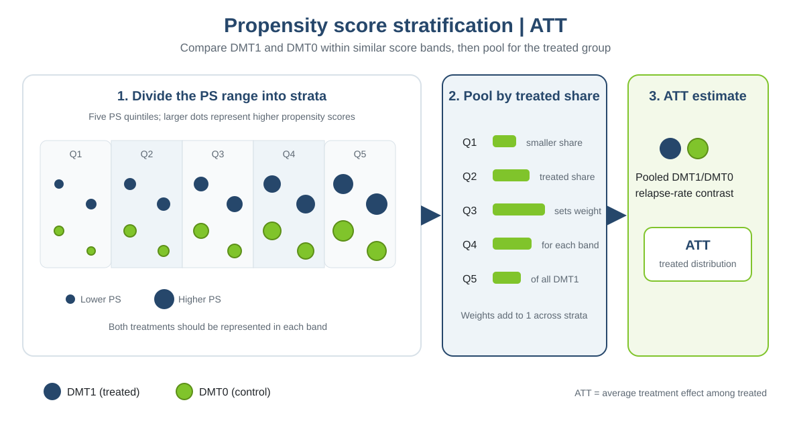

This practical is based on the online chapter [“Confounding adjustment using propensity score methods”](https://smartdata-analysis-and-statistics.github.io/comparative-effectiveness/chapter_06.html), which complements the material in *Comparative Effectiveness and Personalized Medicine Research Using Real-World Data* (pp. 99–123). The book chapter is by Tammy Jiang, Gabrielle Simoneau, Changyu Shen, Fabio Pellegrini, and Carl de Moor.

::: {.callout-note title="How to use this practical"}
Complete the tasks and discussion questions before opening the [worked solution](chapter3_practical3_solution.qmd). The figure and short method summary introduce the analysis.
:::

# Learning objectives

By the end of this practical, you should be able to:

- estimate propensity scores and form quintiles using cut points from the full cohort's score distribution;
- assess whether each stratum contains both treatments and has adequate within-stratum balance and support;
- estimate stratum-specific relapse rate ratios with follow-up time accounted for, then pool them using treated-group shares to target the ATT; and
- use a bootstrap that repeats score estimation, stratum formation, outcome fitting, and pooling to quantify uncertainty.

# 1. How stratification works

{width=100%}

**When to use:** when a simple, transparent adjustment using a manageable number of score bands is useful and both treatments are represented in each band.

**Advantages:** retains people in the analysis and makes it easy to inspect treatment comparisons across score ranges.

**Limitations:** broad strata may leave within-stratum imbalance; sparse strata can make comparisons unstable. The target depends on how stratum effects are pooled.

## Prepare the data

Estimate each participant's propensity score from the prespecified baseline covariates. Divide the sample into five groups using the 20th, 40th, 60th, and 80th percentiles of the estimated scores. These quintiles are mutually exclusive: every participant is assigned to exactly one interval, from the lowest estimated score (quintile 1) to the highest (quintile 5). The cut points are based on the score distribution in the full sample, not on treatment-specific quantiles. Tied scores can produce fewer than five groups, so check the number formed.

```{r}
#| eval: false
library(dplyr)
library(tableone)
library(ggplot2)
library(marginaleffects)
data_file <- if (file.exists("data/chapter3_ps_data.rds")) {
  "data/chapter3_ps_data.rds"
} else {
  "Chapter_3/data/chapter3_ps_data.rds"
}
dat <- readRDS(data_file)
ps_formula <- treatment ~ age + female + prevDMTefficacy +
  premedicalcost + prerelapse_num + numSymptoms
ps_fit <- glm(ps_formula, data = dat, family = binomial())
dat$ps <- predict(ps_fit, type = "response")
cuts <- unique(quantile(dat$ps, seq(0, 1, .2)))
dat$stratum <- cut(dat$ps, cuts, include.lowest = TRUE, labels = FALSE)
length(unique(dat$stratum))
```

# 2. Feasibility and diagnostics

## Counts of each treatment within each stratum

Start by checking how many participants receiving each treatment fall in each quintile. A stratum must contain both treatments to support a within-stratum comparison; very small counts can still make that comparison unstable.

**Tasks:**

1. Report the treated and control counts in each propensity-score stratum.
2. Identify strata with low counts or a missing treatment group.

```{r}
#| eval: false
counts_by_stratum <- as.data.frame.matrix(with(dat, table(stratum, treatment)))
counts_by_stratum$stratum <- rownames(counts_by_stratum)
counts_by_stratum <- counts_by_stratum[, c("stratum", "DMT0", "DMT1")]
knitr::kable(counts_by_stratum, row.names = FALSE)
```

## Within-stratum balance

Within each propensity-score stratum, compare the estimated propensity score and all modeled baseline covariates between DMT1 and DMT0. The table reports means and standard deviations for continuous variables, proportions for categorical variables, and standardized mean differences (SMDs). An absolute SMD below 0.1 is a common diagnostic guide, not proof that confounding has been removed. Also inspect the score distributions within strata; similar means alone can conceal differences in spread or shape.

**Tasks:**

1. Report treatment counts and covariate summaries with SMDs within each stratum.
2. Check whether the estimated propensity score and baseline covariates are adequately balanced in every stratum; identify any weak comparisons.

```{r}
#| eval: false
vars <- c("ps", "age", "female", "prevDMTefficacy", "premedicalcost",
          "prerelapse_num", "numSymptoms")
factor_vars <- c("female", "prevDMTefficacy", "numSymptoms")
balance_by_stratum <- lapply(sort(unique(dat$stratum)), function(s) {
  d <- dat[dat$stratum == s, ]
  tab <- CreateTableOne(
    vars = vars, data = d, factorVars = factor_vars,
    strata = "treatment", test = FALSE
  )
  tab_print <- print(
    tab, catDigits = 2, contDigits = 2, smd = TRUE, printToggle = FALSE
  )
  data.frame(
    stratum = s,
    characteristic = rownames(tab_print),
    DMT0 = tab_print[, "DMT0"],
    DMT1 = tab_print[, "DMT1"],
    SMD = tab_print[, "SMD"],
    row.names = NULL,
    check.names = FALSE
  )
})
knitr::kable(do.call(rbind, balance_by_stratum), row.names = FALSE)
ggplot(dat, aes(x = ps, color = treatment, fill = treatment)) +
  geom_density(alpha = 0.15) +
  facet_wrap(~ stratum, ncol = 1) +
  scale_fill_manual(values = c(DMT0 = "#80c42b", DMT1 = "#26476b")) +
  scale_colour_manual(values = c(DMT0 = "#80c42b", DMT1 = "#26476b")) +
  labs(x = "Estimated propensity score", y = "Density", color = "Treatment",
       fill = "Treatment") +
  theme_minimal()
```

## Does every stratum support a comparison?

Combine treatment counts, within-stratum covariate summaries, propensity-score balance, and the score-density plots to judge support. Every stratum should have both treatment groups, sufficient observations for a stable estimate, and reasonable overlap and balance. If a stratum is too sparse or imbalanced, consider revising the score model or combining adjacent strata only after reassessing balance. Restricting to a supported population changes the target population.

**Tasks:**

1. Based on the treatment counts and balance diagnostics, state whether all five strata support a credible treatment comparison.
2. If one or more strata are too sparse or imbalanced, propose a defensible response and explain its implications for precision or the target population.

# 4. Estimate and pool the treatment effects

Within each stratum, estimate a DMT1/DMT0 annualized relapse rate ratio (ARR) using a Poisson model with `offset(log(years))`, and calculate a 95% confidence interval. Weight each stratum-specific ARR by that stratum's share of all treated participants. In this practical, the pooled ATT summary is the treated-share-weighted mean of the stratum-specific ARRs. Use a percentile bootstrap to estimate uncertainty, repeating propensity-score estimation, quintile formation, stratum-specific outcome models, and pooling in every resample.

**Tasks:**

1. Fit a Poisson outcome model separately within each stratum and report the DMT1/DMT0 ARR and its 95% confidence interval.
2. Calculate each stratum's treated-share weight and weighted ARR contribution, then sum the contributions to obtain the pooled ATT summary.
3. Bootstrap the pooled estimate and report its percentile 95% confidence interval. Explain why the bootstrap repeats the full propensity-score and stratification procedure.

```{r}
#| eval: false
# Fit stratum-specific Poisson models and calculate rate ratios and Wald CIs.
strata <- sort(unique(dat$stratum))
stratum_effects <- do.call(rbind, lapply(strata, function(h) {
  d <- dat[dat$stratum == h, ]
  fit <- glm(y ~ treatment + offset(log(years)),
             family = poisson(link = "log"), data = d)
  beta <- coef(fit)["treatmentDMT1"]
  se <- sqrt(vcov(fit)["treatmentDMT1", "treatmentDMT1"])
  data.frame(
    stratum = h,
    n_DMT0 = sum(d$treatment == "DMT0"),
    n_DMT1 = sum(d$treatment == "DMT1"),
    ARR = unname(exp(beta)),
    ci_lower = unname(exp(beta - 1.96 * se)),
    ci_upper = unname(exp(beta + 1.96 * se))
  )
}))
stratum_effects$att_weight <- stratum_effects$n_DMT1 /
  sum(stratum_effects$n_DMT1)
stratum_effects$weighted_ARR <- stratum_effects$att_weight *
  stratum_effects$ARR
knitr::kable(stratum_effects, digits = 3)
pooled_ATT <- sum(stratum_effects$weighted_ARR)

# Bootstrap the full PS, quintile, outcome-model, and pooling procedure.
stratified_att <- function(data, indices) {
  d <- data[indices, , drop = FALSE]
  ps_fit_b <- try(glm(ps_formula, data = d, family = binomial()), silent = TRUE)
  if (inherits(ps_fit_b, "try-error")) return(NA_real_)
  d$ps <- predict(ps_fit_b, type = "response")
  cuts_b <- unique(quantile(d$ps, probs = seq(0, 1, .2)))
  if (length(cuts_b) != 6) return(NA_real_)
  d$stratum <- cut(d$ps, cuts_b, include.lowest = TRUE, labels = FALSE)
  group_counts <- table(factor(d$stratum, levels = 1:5), d$treatment)
  if (any(group_counts == 0)) return(NA_real_)
  effects_b <- lapply(1:5, function(h) {
    dh <- d[d$stratum == h, ]
    fit <- try(glm(y ~ treatment + offset(log(years)),
                   family = poisson(link = "log"), data = dh), silent = TRUE)
    if (inherits(fit, "try-error")) return(c(n_DMT1 = NA_real_, ARR = NA_real_))
    beta <- coef(fit)["treatmentDMT1"]
    c(n_DMT1 = sum(dh$treatment == "DMT1"), ARR = unname(exp(beta)))
  })
  effects_b <- do.call(rbind, effects_b)
  if (any(!is.finite(effects_b))) return(NA_real_)
  weights_b <- effects_b[, "n_DMT1"] / sum(effects_b[, "n_DMT1"])
  sum(weights_b * effects_b[, "ARR"])
}

set.seed(1854)
n_boot <- 500
boot_ATT <- replicate(
  n_boot,
  stratified_att(dat, sample.int(nrow(dat), replace = TRUE))
)
valid_boot <- boot_ATT[is.finite(boot_ATT)]
bootstrap_ci <- quantile(valid_boot, c(.025, .975), names = FALSE)
data.frame(
  pooled_ATT = pooled_ATT,
  bootstrap_ci_lower = bootstrap_ci[1],
  bootstrap_ci_upper = bootstrap_ci[2],
  successful_replicates = length(valid_boot),
  attempted_replicates = n_boot
)
```

**Questions for discussion:**

1. Why do we check treatment counts and covariate balance within strata, rather than only across the full sample?
2. How does using treated-count weights differ from using total stratum counts?
3. What are the consequences of using too few or too many strata?
4. Why should the bootstrap repeat propensity-score estimation and stratum formation?

::: {.callout-note title="Optional: estimate the ATE instead"}
The main analysis pools stratum-specific rate ratios using each stratum's share of treated patients, so the target is the ATT. To follow the same stratification procedure for an ATE, use each stratum's share of the full cohort instead. The bootstrap below repeats propensity-score estimation, quintile formation, stratum-specific outcome models, and pooling; it changes only the target weights.

```{r}
#| eval: false
stratified_ate <- function(data, indices) {
  d <- data[indices, , drop = FALSE]
  ps_fit_b <- try(glm(ps_formula, data = d, family = binomial()), silent = TRUE)
  if (inherits(ps_fit_b, "try-error")) return(NA_real_)
  d$ps <- predict(ps_fit_b, type = "response")
  cuts_b <- unique(quantile(d$ps, probs = seq(0, 1, .2)))
  if (length(cuts_b) != 6) return(NA_real_)
  d$stratum <- cut(d$ps, cuts_b, include.lowest = TRUE, labels = FALSE)
  group_counts <- table(factor(d$stratum, levels = 1:5), d$treatment)
  if (any(group_counts == 0)) return(NA_real_)

  effects_b <- lapply(1:5, function(h) {
    dh <- d[d$stratum == h, ]
    fit <- try(glm(y ~ treatment + offset(log(years)),
                   family = poisson(link = "log"), data = dh), silent = TRUE)
    if (inherits(fit, "try-error")) return(c(n = NA_real_, ARR = NA_real_))
    c(n = nrow(dh), ARR = unname(exp(coef(fit)["treatmentDMT1"])))
  })
  effects_b <- do.call(rbind, effects_b)
  if (any(!is.finite(effects_b))) return(NA_real_)
  population_weights <- effects_b[, "n"] / sum(effects_b[, "n"])
  sum(population_weights * effects_b[, "ARR"])
}

set.seed(1854)
boot_ATE <- replicate(
  500,
  stratified_ate(dat, sample.int(nrow(dat), replace = TRUE))
)
valid_ATE <- boot_ATE[is.finite(boot_ATE)]
ATE_summary <- data.frame(
  pooled_ATE = stratified_ate(dat, seq_len(nrow(dat))),
  bootstrap_ci_lower = quantile(valid_ATE, .025, names = FALSE),
  bootstrap_ci_upper = quantile(valid_ATE, .975, names = FALSE),
  successful_replicates = length(valid_ATE),
  attempted_replicates = 500
)
ATE_summary
```

This produces a full-cohort-share-weighted mean of the stratum-specific rate ratios. It follows the same pooled-rate-ratio summary as the ATT example but averages over the whole cohort rather than the treated cohort. Interpret it only after checking within-stratum support and balance; the ATE requires credible comparisons across the full cohort.
:::
