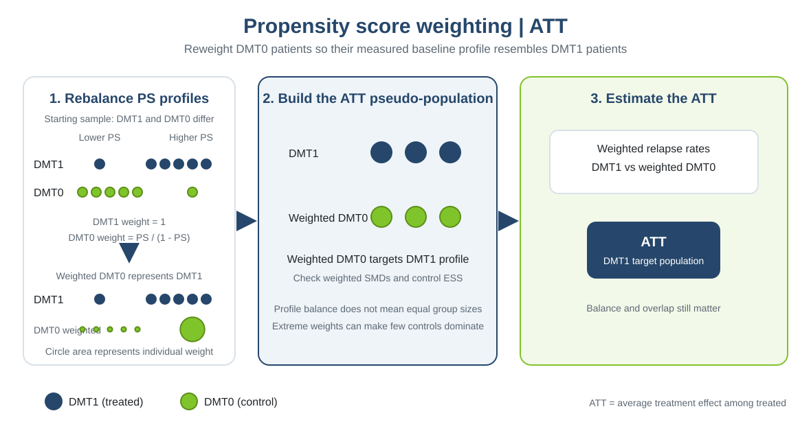

This practical is based on the online chapter [“Confounding adjustment using propensity score methods”](https://smartdata-analysis-and-statistics.github.io/comparative-effectiveness/chapter_06.html), which complements the material in *Comparative Effectiveness and Personalized Medicine Research Using Real-World Data* (pp. 99–123). The book chapter is by Tammy Jiang, Gabrielle Simoneau, Changyu Shen, Fabio Pellegrini, and Carl de Moor.

::: {.callout-note title="How to use this practical"}
Complete the tasks and discussion questions before opening the [worked solution](chapter3_practical4_solution.qmd). The analysis follows Sections 3.6.1–3.6.3 of the [comparative-effectiveness chapter](https://smartdata-analysis-and-statistics.github.io/comparative-effectiveness/chapter_06.html#propensity-score-weighting).
:::

# 1. How ATT weighting works

{width=100%}

In the reference example, a logistic propensity-score model is fitted using age, sex, previous DMT efficacy, and previous relapse count. For the ATT, each treated patient receives weight 1; each control receives `PS / (1 - PS)`. This reweights controls toward the measured baseline profile of treated patients. WeightIt estimates these weights, balance is checked with cobalt, and a weighted Poisson model with log follow-up time as an offset estimates the relapse rate ratio. No weight truncation is applied in the reference code.

# 2. Prepare data

Read the cohort, inspect its structure and treatment counts, then estimate the ATT weights with WeightIt. Use the same four baseline covariates as the reference method; exclude outcome and follow-up variables from the propensity-score model.

**Task:** Load the dataset and libraries, inspect missingness and treatment counts, then estimate the propensity scores and ATT weights. Confirm the treatment groups and the variables used in the PS model.

```{r}
#| eval: true
library(WeightIt)
library(cobalt)
library(survey)
library(ggplot2)
library(dplyr)
data_file <- if (file.exists("data/chapter3_ps_data.rds")) {
  "data/chapter3_ps_data.rds"
} else {
  "Chapter_3/data/chapter3_ps_data.rds"
}
dat <- readRDS(data_file)
dim(dat)
names(dat)
colSums(is.na(dat))
table(dat$treatment)
ps_formula <- treatment ~ age + female + prevDMTefficacy +
  premedicalcost + prerelapse_num + numSymptoms
w.out <- weightit(ps_formula, data = dat, method = "ps", estimand = "ATT")
dat$ps <- w.out$ps
dat$w_att <- w.out$weights
summary(w.out)
```

**Results:** The dataset has 10,000 participants and 10 variables, with 2,396 DMT0 controls and 7,604 DMT1 treated participants. There are no missing values in the displayed fields. The PS model includes age, female, previous DMT efficacy, and prior relapse count. WeightIt estimates the propensity score using logistic regression and applies ATT weights; treatment weights are 1 and control weights are their estimated treatment odds.

# 3. Feasibility and diagnostics

Assess whether the ATT weighting analysis has adequate empirical support. The commonly used absolute SMD threshold of 0.1 is a diagnostic guide; it does not establish exchangeability or eliminate unmeasured confounding.

## Weight distribution

**Task:** Summarize and plot the ATT weights by treatment group. Confirm that treated weights are all one and describe how control weights are distributed.

```{r}
#| eval: true
dat %>% group_by(treatment) %>%
  summarise(n = n(), min = min(w_att), median = median(w_att),
            mean = mean(w_att), max = max(w_att), .groups = "drop")
ggplot(dat, aes(x = w_att, fill = treatment)) +
  geom_histogram(bins = 40, position = "identity", alpha = 0.55) +
  facet_wrap(~ treatment, scales = "free_y") +
  scale_fill_manual(values = c(DMT0 = "#80c42b", DMT1 = "#26476b"),
                    guide = "none") +
  labs(x = "ATT weight", y = "Participants") +
  theme_minimal() + theme(legend.position = "none")
```

**Results:** Treated weights equal 1 throughout. Control weights range from about 0.436 to 46.871; the largest values show that a small number of controls contribute disproportionately.

## Extreme weights

**Task:** Report the control weight quantiles, maximum, and share exceeding 10. Identify whether any truncation rule is used. If proposing truncation, state a rule before estimating a truncated result and note the effect on balance and the target population.

```{r}
#| eval: true
control_w <- dat$w_att[dat$treatment == "DMT0"]
quantile(control_w, probs = c(0, .5, .9, .95, .99, 1))
c(max_weight = max(control_w), share_over_10 = mean(control_w > 10))
# No truncation is applied in this primary analysis.
```

**Results:** In this generated dataset, the control-weight median is 1.65, the 90th percentile is 7.05, and the maximum is 90.80; about 5.9% of control weights exceed 10. The primary analysis applies no truncation, matching the reference code, which estimated unstabilized ATT weights. Truncation is therefore not silently used; any sensitivity analysis should prespecify its cutoff and report how many weights changed, plus ESS and balance after truncation.

## Control ESS

**Task:** Calculate the effective sample size (ESS) of each treatment group from the weights and compare it with its unweighted count. Explain what the difference implies for information and precision. `summary(w.out)$ess` is `NULL` in the installed WeightIt version, so calculate ESS directly as `(sum of weights)^2 / sum of squared weights`.

```{r}
#| eval: true
ess_table <- dat %>%
  group_by(treatment) %>%
  summarise(
    n = n(),
    ess = sum(w_att)^2 / sum(w_att^2),
    .groups = "drop"
  )
ess_table
```

**Results:** The control ESS is about 644, compared with 2,396 actual controls; the treated ESS is 7,604 because all treated ATT weights equal one. The unequal control weights reduce the controls’ effective information to about 27% of their nominal count, which can reduce precision.

## Weighted SMDs

**Task:** Compare unweighted and weighted standardized mean differences for the modeled covariates and estimated propensity score. State whether every absolute weighted SMD is below 0.1, and identify the largest one.

```{r}
#| eval: true
bal.tab(w.out, stats = c("m", "v"), un = TRUE,
        thresholds = c(m = .1))
```

**Results:** All modeled covariates and the propensity score are below the absolute SMD guide of 0.1 after weighting. The largest absolute adjusted SMD is about 0.0208 (prerelapse_num), indicating close measured-covariate balance for these model terms. This does not assess unmeasured factors or guarantee correct model specification.

# 4. Estimate the ATT

Following Section 3.6.3, fit a survey-weighted Poisson regression for relapse counts, including log follow-up time as an offset. The survey design gives model-robust standard errors for the weighted fit.

**Task:** Estimate and report the exponentiated DMT1 coefficient and its 95% confidence interval as the ATT relapse rate ratio. Explain the implications of extreme weights and the control ESS for precision and positivity. Discuss why measured-covariate balance alone does not guarantee an unbiased causal estimate.

```{r}
#| eval: true
weighted.data <- svydesign(ids = ~1, data = dat, weights = ~w_att)
weighted.fit <- svyglm(y ~ treatment + offset(log(years)),
                       family = poisson(link = "log"), design = weighted.data)
exp(coef(weighted.fit)["treatmentDMT1"])
exp(confint(weighted.fit)["treatmentDMT1", ])
```

**Results:** The ATT relapse rate ratio is approximately 0.721 (95% CI 0.635 to 0.817). In this simulated cohort, the weighted treated group has an estimated relapse rate about 28% lower than the weighted counterfactual control rate, under the measured-confounding and model assumptions. Large control weights and the reduced control ESS indicate potential precision and positivity concerns. Good measured balance does not rule out unmeasured confounding, measurement error, or propensity/outcome model misspecification.

**Questions for discussion:**

1. Why can a control with a propensity score near one receive a very large ATT weight?
2. What do you gain and potentially lose by truncating large weights?
3. Why can a well-balanced weighted sample still produce a biased ATT?

::: {.callout-tip title="Discussion answers"}
1. Since ATT control weights are `PS/(1-PS)`, the denominator approaches zero as PS approaches one; such controls have treated-like covariates and are scarce in the control group, signaling weak overlap.
2. Truncation can reduce variance and limit domination by a few observations, but it can reintroduce imbalance and shift the effective target population. Report the cutoff, affected observations, ESS, balance, and both primary and sensitivity estimates.
3. Balance only covers measured covariates represented in the PS model. Unmeasured confounding, poor measurement, model misspecification, and lack of positivity may still bias the ATT.
:::
