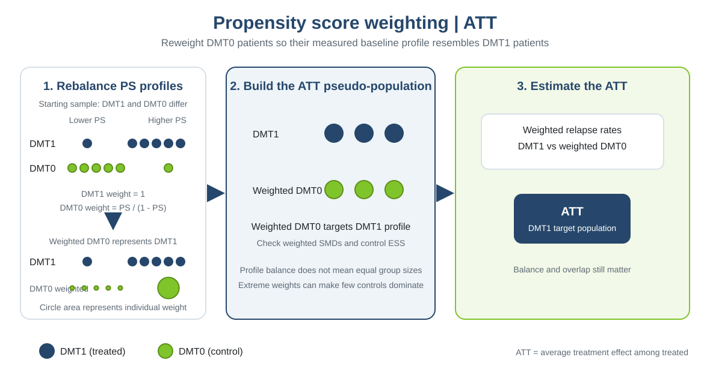

This practical is based on the online chapter [“Confounding adjustment using propensity score methods”](https://smartdata-analysis-and-statistics.github.io/comparative-effectiveness/chapter_06.html), which complements the material in *Comparative Effectiveness and Personalized Medicine Research Using Real-World Data* (pp. 99–123). The book chapter is by Tammy Jiang, Gabrielle Simoneau, Changyu Shen, Fabio Pellegrini, and Carl de Moor.

::: {.callout-note title="How to use this practical"}
Complete the tasks and discussion questions before opening the [worked solution](chapter3_practical4_solution.qmd). The analysis follows Sections 3.6.1–3.6.3 of the [comparative-effectiveness chapter](https://smartdata-analysis-and-statistics.github.io/comparative-effectiveness/chapter_06.html#propensity-score-weighting).
:::

# 1. How ATT weighting works

{width=100%}

This practical estimates the propensity score from the six prespecified pretreatment covariates used in Practicals 1–3: age, sex, previous DMT efficacy, premedical cost, prior relapse count, and symptom count. For the ATT, each treated patient receives weight 1; each control receives `PS / (1 - PS)`. This reweights controls toward the measured baseline profile of treated patients. WeightIt estimates these weights, balance is checked with cobalt, and a weighted Poisson model with log follow-up time as an offset estimates the relapse rate ratio. No weight truncation is applied in the primary analysis.

# 2. Prepare data

Read the cohort, inspect its structure and treatment counts, then estimate the ATT weights with WeightIt. Use the same six prespecified pretreatment covariates as Practicals 1–3; exclude outcome and follow-up variables from the propensity-score model.

**Task:** Load the dataset and libraries, inspect missingness and treatment counts, then estimate the propensity scores and ATT weights. Confirm the treatment groups and the variables used in the PS model.

```{r}
#| eval: false
library(WeightIt)
library(cobalt)
library(survey)
library(ggplot2)
library(dplyr)
data_file <- if (file.exists("data/chapter3_ps_data.rds")) {
  "data/chapter3_ps_data.rds"
} else {
  "Chapter_3/data/chapter3_ps_data.rds"
}
dat <- readRDS(data_file)
dim(dat)
names(dat)
colSums(is.na(dat))
table(dat$treatment)
ps_formula <- treatment ~ age + female + prevDMTefficacy +
  premedicalcost + prerelapse_num + numSymptoms
w.out <- weightit(ps_formula, data = dat, method = "ps", estimand = "ATT")
dat$ps <- w.out$ps
dat$w_att <- w.out$weights
summary(w.out)
```

# 3. Feasibility and diagnostics

Assess whether the ATT weighting analysis has adequate empirical support. The commonly used absolute SMD threshold of 0.1 is a diagnostic guide; it does not establish exchangeability or eliminate unmeasured confounding.

## Weight distribution

**Task:** Summarize and plot the ATT weights by treatment group. Confirm that treated weights are all one and describe how control weights are distributed.

```{r}
#| eval: false
dat %>% group_by(treatment) %>%
  summarise(n = n(), min = min(w_att), median = median(w_att),
            mean = mean(w_att), max = max(w_att), .groups = "drop")
ggplot(dat, aes(x = w_att, fill = treatment)) +
  geom_histogram(bins = 40, position = "identity", alpha = 0.55) +
  facet_wrap(~ treatment, scales = "free_y") +
  scale_fill_manual(values = c(DMT0 = "#80c42b", DMT1 = "#26476b"),
                    guide = "none") +
  scale_fill_manual(values = c(DMT0 = "#80c42b", DMT1 = "#26476b"),
                    guide = "none") +
  labs(x = "ATT weight", y = "Participants") +
  theme_minimal() + theme(legend.position = "none")
```

## Extreme weights

**Task:** Report the control weight quantiles, maximum, and share exceeding 10. Identify whether any truncation rule is used. If proposing truncation, state a rule before estimating a truncated result and note the effect on balance and the target population.

```{r}
#| eval: false
control_w <- dat$w_att[dat$treatment == "DMT0"]
quantile(control_w, probs = c(0, .5, .9, .95, .99, 1))
c(max_weight = max(control_w), share_over_10 = mean(control_w > 10))
# No truncation is applied in this primary analysis.
```

## Effective sample size

**Task:** Calculate the effective sample size (ESS) of each treatment group from the weights and compare it with its unweighted count. Explain what the difference implies for information and precision. `summary(w.out)$ess` is `NULL` in the installed WeightIt version, so calculate ESS directly as `(sum of weights)^2 / sum of squared weights`.

```{r}
#| eval: false
ess_table <- dat %>%
  group_by(treatment) %>%
  summarise(
    n = n(),
    ess = sum(w_att)^2 / sum(w_att^2),
    .groups = "drop"
  )
ess_table
```

## Weighted standardized mean differences (SMDs)

**Task:** Compare unweighted and weighted standardized mean differences for the modeled covariates and estimated propensity score. State whether every absolute weighted SMD is below 0.1, and identify the largest one.

```{r}
#| eval: false
bal.tab(w.out, stats = c("m", "v"), un = TRUE,
        thresholds = c(m = .1))
```

# 4. Estimate the ATT

Following Section 3.6.3, fit a survey-weighted Poisson regression for relapse counts, including log follow-up time as an offset. The survey design gives model-robust standard errors for the weighted fit.

**Task:** Estimate and report the exponentiated DMT1 coefficient and its 95% confidence interval as the ATT relapse rate ratio. Explain the implications of extreme weights and the control ESS for precision and positivity. Discuss why measured-covariate balance alone does not guarantee an unbiased causal estimate.

```{r}
#| eval: false
weighted.data <- svydesign(ids = ~1, data = dat, weights = ~w_att)
weighted.fit <- svyglm(y ~ treatment + offset(log(years)),
                       family = poisson(link = "log"), design = weighted.data)
exp(coef(weighted.fit)["treatmentDMT1"])
exp(confint(weighted.fit)["treatmentDMT1", ])
```

**Questions for discussion:**

1. Why can a control with a propensity score near one receive a very large ATT weight?
2. What do you gain and potentially lose by truncating large weights?
3. Why can a well-balanced weighted sample still produce a biased ATT?

::: {.callout-note title="Optional: estimate the ATE instead"}
The main analysis estimates the ATT using weights of 1 for DMT1 and `PS/(1-PS)` for DMT0. To target the ATE, refit the same propensity-score model using ATE weights, then repeat the weight, ESS, and balance checks before fitting the same survey-weighted Poisson outcome model. ATE weights are `1/PS` for DMT1 and `1/(1-PS)` for DMT0. The full cohort is the target only where both treatments have adequate support.

```{r}
#| eval: false
w_ate.out <- weightit(ps_formula, data = dat, method = "ps", estimand = "ATE")
dat$w_ate <- w_ate.out$weights

# Recheck the diagnostics for the ATE weights; do not reuse ATT diagnostics.
dat %>% group_by(treatment) %>%
  summarise(
    n = n(), min = min(w_ate), median = median(w_ate),
    max = max(w_ate), ess = sum(w_ate)^2 / sum(w_ate^2),
    .groups = "drop"
  )
bal.tab(w_ate.out, stats = c("m", "v"), un = TRUE,
        thresholds = c(m = .1))

weighted.ate.data <- svydesign(ids = ~1, data = dat, weights = ~w_ate)
weighted.ate.fit <- svyglm(
  y ~ treatment + offset(log(years)),
  family = poisson(link = "log"), design = weighted.ate.data
)
exp(coef(weighted.ate.fit)["treatmentDMT1"])
exp(confint(weighted.ate.fit)["treatmentDMT1", ])
```

Interpret the result as the DMT1-versus-DMT0 relapse rate ratio for the full cohort represented by the ATE weights. Check the ATE weight distribution, effective sample sizes, balance, and overlap before interpreting the estimate; extreme weights or poor support can make this target unreliable.
:::
