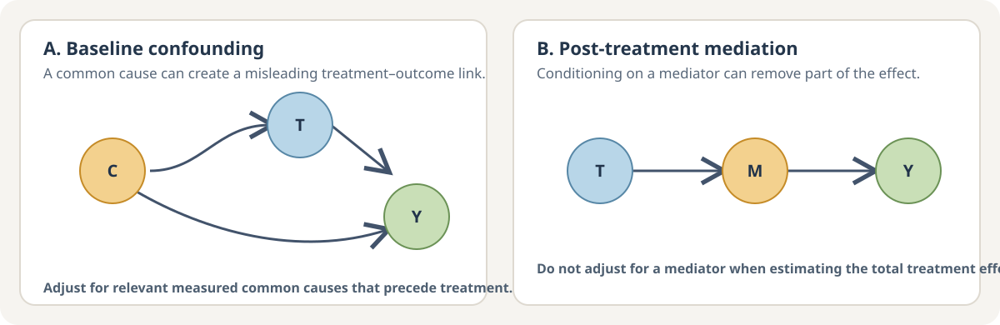
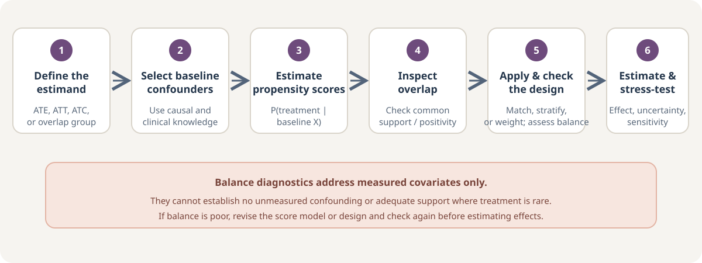

In real-world data, treatment choice may depend on age, disease severity, or expected benefit. These characteristics can also predict outcomes, so a direct comparison may mix treatment effects with pre-existing differences between patients.

Propensity score methods can make measured baseline characteristics more comparable before estimating an effect. They do not turn observational data into a randomized trial or remove bias from unmeasured factors.

## What you will learn

After this mini chapter, you should be able to:

- explain what the score represents and what it can balance;
- select pre-treatment confounders and define the target population; and
- assess overlap and balance without overstating what the checks prove.

## Start with the causal question

The propensity score is the probability of receiving a treatment given measured, pre-treatment characteristics. Similar scores tend to indicate similar distributions of the measured covariates in the model.

Define whose effect matters: the **ATE** targets the full eligible population, the **ATT** those treated, the **ATC** those receiving the comparator, and the **ATO** patients in treatment equipoise. This choice affects weighting, matching, and interpretation.

Use clinical knowledge and a causal diagram to select covariates. Include measured common causes before treatment; avoid mediators and colliders. Treatment predictors that do not control confounding may worsen overlap or precision. The goal is balance, not prediction.

{#fig-covariate-selection fig-alt="Panel one: baseline confounder C points to treatment T and outcome Y, while T also points to Y. Panel two: treatment T points to mediator M, which points to outcome Y. The contrast highlights why pre-treatment common causes may need adjustment and why adjusting for a mediator changes the treatment effect being estimated." width=100%}

## Choose an approach, then check its consequences

**Matching** pairs similar patients but may exclude unmatched patients. **Stratification** compares treatments within score bands, then pools results for the target population. **Weighting** reweights patients to reduce measured differences; extreme weights can destabilize estimates. **Score adjustment** includes the continuous score in an outcome model and depends on modeling it correctly.

Inspect score overlap first: comparisons are weak where one treatment has little support from the other. Then compare covariate distributions. An absolute standardized mean difference below 0.1 is a common guide, not a pass mark; inspect distributions as well as means.

{#fig-ps-workflow fig-alt="Six connected stages: define the estimand, select baseline covariates, estimate propensity scores, inspect overlap, apply a score method and check balance, then estimate and stress-test the effect. A warning below the workflow notes that diagnostics address measured data and do not establish the causal assumptions." width=100%}

## Treat diagnostics as evidence, not proof

Propensity score analyses still require no important unmeasured confounding, adequate overlap, well-defined treatments, and no interference. Balance checks address measured covariates only and cannot guarantee an unbiased effect.

Plan for missing covariates before estimating scores. Complete-case analysis can reduce precision and select a different population. With multiple imputation, include treatment, outcome, confounders, and useful auxiliary variables; estimate the score and effect in each dataset, then pool. Sensitivity analyses can probe unmeasured confounding, measurement error, and analytic choices.

## Continue in the book

Read Chapter 7 for matching algorithms and inference; weighting, extreme weights, and trimming; balance diagnostics; imputation strategies; and sensitivity analyses for confounding and measurement error. Its multiple-sclerosis example shows how adjustment can reverse an unadjusted comparison. Supplementary code gives implementation details.

**Key takeaway:** define the effect and target population first, select defensible pre-treatment confounders, check overlap and measured balance, and report the assumptions and sensitivity analyses that still govern the conclusion.
